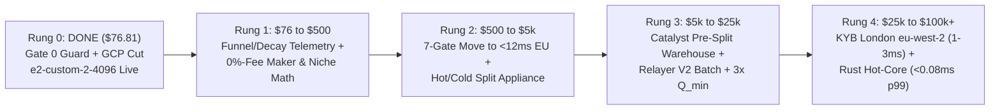
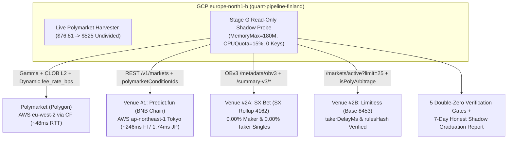

# Dominus Master Plan (v4.2 — Granular Profit-Gate & 18-Sub-Bracket Step-by-Step Engineering Edition): `$76.81` → `$50,000+` / `$100,000+`

> [!CAUTION]
> **P0 Gate 0 — Operator, Entity & Multi-Venue Institutional Eligibility (Mandatory Pre-Condition Before Capital Scaling or Migration):**
> 1. **Terms of Use Control Rule:** Server geography (`Finland`, `Sweden`, `Netherlands`, `Ireland`, `Tokyo`, or `London`) **never** overrides operator/beneficial-owner restrictions under Polymarket's August 11, 2026 Terms of Use (which restrict residents/entities in Ontario `CA-ON` under the April 2025 OSC settlement through at least April 2027, US on international `polymarket.com`, UK, NL, IE, FR, DE, etc., as well as trading *"under the direction or control of"* Restricted Persons), nor venue-specific Terms on `Limitless` (`US`, `UK`, `CA-ON`, `CA-AB`, `FR`, `DE`), `SX Bet` (`US`, `CA-ON`, `UK`, `FR`), or `Predict.fun` (`US`, `UK`, `FR`, `SG`, Mainland China).
> 2. **Hard Rule:** Do **not** wire external scale capital (`$5k–$100k+`), form shell entities without genuine operational control in an eligible jurisdiction, fund cross-venue wallets, or migrate production infrastructure until personal/entity eligibility under each target venue's Terms of Use is legally confirmed.
> 3. **Institutional KYB Co-Location Track (`$0` Early Inquiry) & Strict `eu-west-2` Geoblock Guard:** Standard `AWS eu-west-2` (London) IPs are geoblocked (`close-only`) on `clob.polymarket.com`. **Never** migrate Polymarket order placement into `eu-west-2` prior to Rung 4 Institutional KYB IP Allowlisting; Rung 2 (`$500+`) proximity upgrades must use verified `blocked == false` non-burstable EU compute (e.g., Stockholm `eu-north-1` / `europe-north2`). Submit Polymarket's Institutional / Market Maker KYB inquiry early so review runs in parallel while software stages compound net edge.

---

## 1. The Simple One-Page Institutional Master Map (`$76.81` Seed $\to$ `$100,000+` Desk)

### Why Sequencing Determines Survival vs. Tier-1 Dominance
At `$76.81` seed equity in Finland (`~48 ms` RTT, `POST /order p50 = 72.0 ms`, `~0.58 ms` internal Python hot path):
* Rewriting Python (`0.58 ms`) into Rust (`0.05 ms`) while `48 ms` away saves **`0.7%` of round-trip time (`$0` extra fills)**.
* Renting `$300/mo` bare-metal on a `$76.81` account imposes a **`-390%/month` fixed burn**.
* Pre-splitting `$1.00` `YES + NO` inventory across 100 markets is mathematically impossible (`5`-share minimum = `$500` minimum).

**The Institutional Law:** Solve the **actual binding constraint at each bankroll tier**, so **every rung funds the next rung out of reconciled Net Economic PnL**.



| Rung | Bankroll / Trigger Gate | Infra Target | Primary Bottleneck Solved | Competitive Tier Reached |
| :---: | :--- | :---: | :--- | :--- |
| **Rung 0** | **COMPLETED (`Nov 7, 2026`, `$76.81`)** | `CA$148` $\to$ `~CA$72/mo` | Compressed `zlib` `45s`-idle SSH dashboard (`Stage A1`), disabled Network Intelligence + cleaned Montreal/snapshot waste (`Stage A2`), quiescent in-place resize to `e2-custom-2-4096` @ `35.228.98.39` (`Stage A3`) | **Production-Safe Seed** |
| **Rung 1** | **`$76` $\to$ `$500` (`$0` Code Sprint)** | `~CA$72/mo` (`-> CA$45/mo` post-disk) | Measure **6-Stage Opportunity Funnel + `Competitor Decay Time`**, harden **15-Leg Non-Atomic Basket State Machine**, and dominate **`0 ms`-effective-latency `#1` FIFO Resting Makers + Multi-Market Niche Math** where `48 ms` Finland wins | **Top 1% Boutique Quant** |
| **Rung 2** | **`$500` $\to$ `$5,000`** *(Gate 0 + Missed `10–35 ms` edge `> 5x` VM delta)* | `~US$35–$65/mo` *(paid by PnL)* | **7-Gate Quiescent Handover** to `<12 ms` approved EU region (`POST /order p50` `72 ms` $\to$ `~32 ms`) + **Hot Execution Appliance vs. Cold Research Plane** split + single-candle `PreSplitInventoryGun` | **Tier-2 Prop Desk (`<18 ms` one-way)** |
| **Rung 3** | **`$5,000` $\to$ `$25,000`** *(Reconciled discrepancy `== $0.0000`)* | `~US$120/mo` *(isolated cores)* | **Catalyst-Driven Revolving Pre-Split Inventory Warehouse** (`15–40` markets pre-minted `T - 5m` before FOMC/CPI/NBA 4Q via gasless Relayer V2, `0s` Polygon settlement wait) + **`CompleteSetRewardShield` (`3x Q_min`)** | **Junior Institutional MM** |
| **Rung 4** | **`$25,000` $\to$ `$100,000+`** *(Institutional KYB approved)* | `< 2%` of monthly Net PnL | **Direct `AWS eu-west-2` London Institutional Co-Location (`~1–3 ms` RTT)** + **`dominus_hotcore` Rust/PyO3 Sidecar** (`< 80 µs` internal p99, `0.00 ms` GC) + **Standing `500`-Market 3-Pool Treasury** sweeping full L1–L3 depth | **Best-in-Class Tier-1 Institutional HFT / MM** |

---

## 2. 5-Dimension Competitive Benchmark & Institutional Gap-Closing Matrix

| Dimension | vs. Typical Polymarket Bots | Current vs. Top Tier-1 HFT / Institutional MMs | Why Today | Exact Institutional Upgrade Path to Reach Tier-1 Best-in-Class |
| :--- | :---: | :---: | :--- | :--- |
| **1. Strategy Breadth & Structural Math** | **Much Better** | **Competitive / Better in niches** $\to$ **Target: #1 Institutional Standard** | Most bots only scan `YES + NO < $1` or naive `NegRisk` sums. `riskless_protocol_v2_expansion.py`, `riskless_frontier_v3_engine.py`, and `riskless_frontier_v4_engine.py` verify exhaustive state-payoff matrices ($\min_\omega V_T(\omega) \ge \$1.00$) across crypto, sports sub-periods, METAR `T`-remarks, `NegRiskAdapter` closed partitions, and UMA liveness carry. | **Stage D:** Invert from Taker-ask scanner to **Continuous State-Space Implied Synthetic Maker Quoter** (projecting unified state vector $\vec{\pi} \in \Delta^{|\Omega|}$ across linked trees to rest `0%`-fee + `20%`-rebate quotes on child rungs backed by deep parent books) + split **Class A (Algebraic)** vs. **Class B (Statistical `LCB_95 > $0`)** graduation. |
| **2. Trap & Microstructure Hardening** | **Much Better** | **On Par** $\to$ **Target: Zero-Leakage Institutional Standard** | Hard guards against cross-oracle basis (`Binance != Chainlink`), `aug=True` `"Other"` `NegRisk` dilution, OT vs. regulation mismatches, fragile-leg-first `FOK` routing, sticky `#1` FIFO rank protection, `REBOOT1` `HTTP 425/503` guard, and 2026 `20%` Maker rebate math. | **Stage C:** Wrap `POST /orders` in an explicit **15-Leg Non-Atomic Basket State Machine** (`PENDING -> FILLED / REJECTED / UNKNOWN -> USER_WS_RECONCILED -> UNWOUND` with auto-sleeve halt on unwind bleed), add **Ancillary-Rules SHA-256 Drift Auto-Cancel (`<1s`)**, and enforce **`1s/5s/30s` Maker Adverse-Markout Shields**. |
| **3. Internal Software Hot Path** | **Better** | **Slightly Worse** *(Python vs. Rust/C++)* $\to$ **Target: `< 0.08 ms` p99** | `FastV2OrderSigner` signs EIP-712 in `~0.23 ms`, `PreSignedOrderLadderCache` pre-builds `+1/+2` tick Maker repegs, RAM pre-balance takes `0 ms`, and `/dev/shm` IPC takes `~0.02 ms`. Median `< 1 ms` only matters once network RTT `< 5 ms`, though Python GC / CPU contention causes p99 tail spikes. | **Stage C (`$0` Now):** `systemd` CPU/nice isolation, `gc.freeze()` + off-tick `gc.collect(0)`, zero-copy tick dispatch.<br>**Stage F (`Rung 4` at `<5 ms` RTT):** Surgical `~1,200`-line **`rust/dominus_hotcore` PyO3/Sidecar** (`simd-json` L2 book + `libsecp256k1` EIP-712 `~18 µs` + pre-armed tick table + warm TLS socket `< 80 µs` p99, keeping 42 research engines in Python). |
| **4. Network Latency (Geography)** | **Better than US (`~140 ms`)** | **Worse** *(`~48 ms` vs. `~5–15 ms`)* $\to$ **Target: `~1–3 ms` London Co-Lo** | From Finland (`europe-north1`), warm RTT to `clob.polymarket.com` (`AWS eu-west-2` London) is `~47–50 ms` (`POST /order p50 = 72.0 ms`). Bots `6–15 ms` from London beat us on contested single-book Taker `FOK` sweeps. | **Stage B/D (At `48 ms`):** Prioritize `#1` FIFO Resting Makers (`0 ms` matching latency in London!) + uncontested cross-slate niches.<br>**Stage E (`Rung 2`):** **7-Gate Handover** to `<12 ms` approved EU region (`POST /order p50 ~32 ms`) + Hot/Cold VM split.<br>**Stage F (`Rung 4`):** Official **Polymarket KYB `AWS eu-west-2` London Allowlist (`~1–3 ms` RTT)**. |
| **5. Capital & Pre-Split Inventory** | **Worse (`$76.81` seed)** | **Much Worse** *(`$77` vs. `$100k+`)* $\to$ **Target: `$100k+` 3-Pool Treasury** | Top MMs hold pre-split `YES + NO` inventory across hundreds of markets to sell instantly without waiting `2–8s` for Polygon ERC-1155 batch settlement, and sweep full L1/L2 depth. At `$76.81`, `5`-share minimums limit clips to `$0.05–$0.34`. | **Stages D–F (4-Tier Inventory Ladder):**<br>• `$76–$250`: `0%` idle pre-split; max `bps/hr` velocity + `<6s` gasless Relayer V2 merges.<br>• `$250–$1.5k`: Single-candle `PreSplitInventoryGun` (`BTC/ETH 15m`, `<35 ms` overround sell).<br>• `$1.5k–$25k`: **Catalyst Pre-Split Warehouse** (`15–40` markets `T - 5m` pre-event) + `3x Q_min` `CompleteSetRewardShield`.<br>• `$25k–$100k+`: **Standing `500`-Market Treasury** (`35%` `pUSD` / `50%` Pre-Split Sets / `15%` Relayer Buffer). |

---

## 3. Governing Economic Identity (Zero Double-Counting)

Every engineering, latency, and capital-allocation decision is evaluated strictly on **reconciled wallet-to-wallet net economics** (each revenue and cost term counted **exactly once**):

$$\text{Net Economic PnL} = (\text{Ending Reconciled Equity} - \text{Starting Reconciled Equity} - \text{Net Deposits}) - \text{Cloud \& Data Infra Cost}$$

Decomposed across non-overlapping strategy attribution books $s \in \mathcal{S}$:

$$\text{Net Economic PnL} = \sum_{s \in \mathcal{S}} \Big( \text{Gross Capture}_{s} - \text{Taker Fees}_{s} + \text{Paid Maker Rebates}_{s} + \text{Paid Liquidity/Holding Rewards}_{s} - \text{Partial-Basket Unwind Loss}_{s} - \text{On-Chain Gas}_{s} - \text{Adverse Markout}_{s} \Big) - \text{Fixed Infra Cost}$$

* **Rebates & Rewards Recognition Rule:** Maker rebates (`20%` `crypto_fees_v2` share) and `Q_min` / `4%` Holding Rewards are booked to realized equity **only when settled on-chain in `pUSD`/`USDC.e`** (estimated accruals are tracked separately as `Estimated Unsettled Rebates`).
* **Seed-Scale Hurdle Reality (`US$76.81` / `~CA$107` Equity):** Even after cutting GCP burn from `CA$148/mo` to `~CA$72/mo` (`~US$51/mo`), fixed infrastructure requires `+66%/month` on a `$77` seed (or `+5.1%/month` at `$1,000`, and `0.05%/month` at `$100,000`). Therefore, **proving high `Net PnL per $1,000 Traded` and `Net PnL per Occupied Capital-Hour` comes strictly before adding fixed monthly cloud spend**.

---

## 4. Verified Ground-Truth GCP Billing Baseline (`parnasa-498503`) & Stage A Runbooks

*(Verified from live Cloud Billing SKU export Oct 24 – Nov 7, 2026; pre-cleanup forecast = `CA$148/mo` net after SUDs)*

| Cost Bucket | Verified GCP SKU IDs | 15-Day Actual (`CA$`) | Pre-Cleanup 30-Day (`CA$`) | Remediation & Live Status (`Nov 7, 2026`) |
| :--- | :--- | ---: | ---: | :--- |
| **Finland E2 Compute** | `0981-D144-B18E` (`CA$23.45`) + `779E-BED5-F31F` (`CA$12.57`) | `CA$36.02` | `~CA$61.50` | **DONE (`Stage A3`):** Resized in-place to **`e2-custom-2-4096`** (`2` full `100%` vCPUs + `4 GB` RAM @ `35.228.98.39`, saving `~CA$12.50/mo` with zero CPU throttling) |
| **Finland `100 GB pd-balanced` Disk** | `ABEC-4750-B9EF` | `CA$7.36` | `~CA$14.72` | Kept in-place for zero split-brain risk; only replace with `40 GB pd-standard` (`~CA$2.20/mo`) during Stage E 7-Gate Handover |
| **Egress: `Finland -> Americas` (SSH Poll)** | `112B-863D-B077` | `CA$11.97` | `~CA$23.94` | **DONE (`Stage A1`):** `6.3x` `zlib` persistent SSH stream + `45s` idle sleep + auto-port reclaim in `scripts/dominus_command_center.py` |
| **Egress: Carrier Peering + EMEA (Market WS)** | `F603-6008-38E5` (`CA$8.34`) + `366A-627A-2073` (`CA$5.79`) | `CA$14.13` | `~CA$28.26` | Benchmark `STANDARD` Tier (`200 GiB/mo` free egress) on `N >= 500` samples before modifying production Network Tier |
| **Montreal Cloud Run Jobs + Services** | `ED10-2CB0-996B` (`CA$3.90`), `085C-A237-027A` (`CA$3.86`), RAM (`CA$0.84`) | `CA$8.60` | `~CA$17.20` | **DONE (`Stage A2`):** Audited & paused/deleted unused `northamerica-northeast1` schedulers/jobs |
| **Orphaned PD Snapshots & Image (`Asia/JP/EU`)** | `6E69-DD68-8DCA` (`CA$1.33`), `9ECE-16D9-A2B4` (`CA$1.03`), `8C30-3296-3468` (`CA$0.62`), `DAA2-253C-6680` (`CA$0.47`) | `CA$3.45` | `~CA$6.90` | **DONE (`Stage A2`):** Deleted non-Finland orphaned snapshots/images (preserved `quant-pipeline-finland-image`) |
| **Network Intelligence Center** | `9BF8-CD36-F9B8` (`CA$0.54`), `D9AD-28F8-05D8` (`CA$0.54`), `BDBA-22FA-3925` (`CA$0.39`) | `CA$1.47` | `~CA$2.94` | **DONE (`Stage A2`):** Disabled `networkmanagement.googleapis.com` & `networkintelligence.googleapis.com` + Topology/Analyzer UI |

> [!WARNING]
> **Two Critical GCP Machine-Type Lessons Enforced Forever:**
> 1. **Never use `e2-medium`:** `e2-medium` exposes 2 logical vCPUs to Linux **but throttles sustained CPU at `50%` (`1.0` core)**. Always use **`e2-custom-2-4096`** (`2` full `100%` sustained vCPUs + `4 GB` RAM).
> 2. **Always pass `--machine-type=e2-custom-2-4096` explicitly:** Passing `--custom-cpu=2 --custom-memory=4GB` *without* `--machine-type=e2-custom-2-4096` (or `--custom-vm-type=e2`) defaults `gcloud` onto legacy **N1** (`n1-custom-2-4096`), triggering `ZONE_RESOURCE_POOL_EXHAUSTED` in `europe-north1-b`.

### Reference Runbook — Stage A3 Quiescent In-Place Resize / Maintenance Template (Cloud Shell)
*(Verified live Nov 7, 2026 on `quant-pipeline-finland` -> `35.228.98.39`)*

```bash
export PROJECT_ID="parnasa-498503"
export ZONE="europe-north1-b"
export VM="quant-pipeline-finland"
export CLOUDSDK_METRICS_ENVIRONMENT="${CLOUDSDK_METRICS_ENVIRONMENT:+$CLOUDSDK_METRICS_ENVIRONMENT }datacloud.cloud-shell"

# 1. QUIESCE DAEMONS, CANCEL RESTING CLOB MAKER ORDERS, ATOMIC SQLITE BACKUP & APPLY SYSCTLS:
gcloud compute ssh "skybullet1987@${VM}" --project="$PROJECT_ID" --zone="$ZONE" -- bash -s << 'EOF'
set -e
export XDG_RUNTIME_DIR="/run/user/$(id -u)"
cd ~/quant_pipeline

systemctl --user stop polymarket-paa-director-event.path 2>/dev/null || true
systemctl --user stop \
  polymarket-paa-director.timer \
  polymarket-paa-monitor.timer \
  polymarket-telemetry-compactor.timer \
  polymarket-live-harvester.service \
  polymarket-alpha124-shadow.service \
  polymarket-recorder.service || true
sleep 2

venv/bin/python3 - << 'PY'
from dotenv import load_dotenv
load_dotenv(".env")
from src.polymarket_research.polymarket_live_executor import PolymarketLiveExecutor
ex = PolymarketLiveExecutor(dry_run=False)
if ex.client is not None:
    print("cancel_all response:", ex.client.cancel_all())
PY

if [ -f data/polymarket/paa_autonomy.db ]; then
  sqlite3 data/polymarket/paa_autonomy.db ".backup 'data/polymarket/paa_autonomy.pre_resize.bak.db'"
  sqlite3 data/polymarket/paa_autonomy.pre_resize.bak.db "PRAGMA integrity_check;"
fi

if [ -f systemd/99-dominus-lowlatency.conf ]; then
  sudo cp systemd/99-dominus-lowlatency.conf /etc/sysctl.d/99-dominus-lowlatency.conf
  sudo sysctl --system >/dev/null
fi
EOF

# 2. STOP, SET TRUE E2 CUSTOM SHAPE (--machine-type=e2-custom-2-4096), AND BOOT WITH FALLBACK:
gcloud compute instances stop "$VM" --project="$PROJECT_ID" --zone="$ZONE"
gcloud compute instances set-machine-type "$VM" --project="$PROJECT_ID" --zone="$ZONE" \
  --machine-type=e2-custom-2-4096
if ! gcloud compute instances start "$VM" --project="$PROJECT_ID" --zone="$ZONE"; then
  gcloud compute instances set-machine-type "$VM" --project="$PROJECT_ID" --zone="$ZONE" --machine-type=e2-standard-2
  gcloud compute instances start "$VM" --project="$PROJECT_ID" --zone="$ZONE"
fi

# 3. PRINT NEW EXTERNAL IP FOR C:\Users\Anton\.ssh\config & VERIFY RECONCILIATION:
sleep 25
NEW_EXT_IP="$(gcloud compute instances describe "$VM" --project="$PROJECT_ID" --zone="$ZONE" --format='get(networkInterfaces[0].accessConfigs[0].natIP)')"
echo "NEW EXTERNAL IP FOR kraken-finland: ${NEW_EXT_IP}"
```

### Reference Runbook — Stage A4 Full 7-Gate Quiescent Handover (Mandatory When Replacing Disk or Region)
Never perform an un-fenced live `rsync` across two VMs. Execute all **7 mandatory gates**:
1. **Gate 1 — Full Inventory Preflight:** Enumerate every active service, timer, `.path` unit, SQLite WAL database (`paa_autonomy.db`), JSON state file (`live_harvester_state.json`), open CLOB order (`GET /data/orders`), and on-chain `pUSD`/`USDC.e`/ERC-1155 balance.
2. **Gate 2 — Read-Only Staging & `N >= 500` Qualification (Zero Wallet Credentials Active):**
   * Create candidate VM (`--machine-type=e2-custom-2-4096` or `c4d-highcpu`, never `e2-medium`).
   * Run `scripts/check_polymarket_region_latency.py --samples 500 --ws-probe --feed-probe` **WITHOUT** `--verify-post-only` so zero orders touch the live wallet while the old VM runs. Compare `p50`, `p95`, `p99`, and IQR jitter across matched time-of-day windows.
3. **Gate 3 — Quiescence & Resting-Order Drain on Old Writer:**
   * Set drain/halt flag, call `ex.client.cancel_all()` to confirm **`0` resting Maker orders remain exposed on Polymarket**, and stop all `polymarket-*` services, timers, and `.path` units.
4. **Gate 4 — Durable Single-Writer Fence on Old VM:**
   * Hard-fence the old VM before final state sync so an accidental reboot or timer can **never** create a dual-writer split-brain:
     ```bash
     systemctl --user mask polymarket-live-harvester.service polymarket-recorder.service polymarket-alpha124-shadow.service
     mv ~/quant_pipeline/.env ~/quant_pipeline/.env.FENCED_MIGRATED
     ```
5. **Gate 5 — Atomic SQLite Backup + Checksummed State Transfer:**
   * Run `sqlite3 paa_autonomy.db ".backup 'paa_autonomy.clean.db'"`, verify `PRAGMA integrity_check == ok`, transfer `data/` via `rsync -azc` (`--checksum`), replace `paa_autonomy.db` with `paa_autonomy.clean.db` (removing stale `-wal`/`-shm` files), and verify SHA-256 hashes of `live_harvester_state.json` and `.env`.
6. **Gate 6 — Observation-Only Reconciliation Before Live Enablement:**
   * Boot candidate VM in **dry-run / read-only reconciliation mode** first: confirm on-chain `pUSD`/`USDC.e` balance, ERC-1155 positions, and `0` unexpected open CLOB orders (`accounting_discrepancy_usd == 0.0000`), then run `--verify-post-only --canary-trials 3` once single-writer ownership is confirmed.
7. **Gate 7 — Activation + Tested Reconciled Rollback:**
   * Enable `loginctl enable-linger skybullet1987` and explicit unit list (`enable --now` each specific `.service` and `.timer`). Keep old VM `STOPPED` (fenced) for 7+ days; any rollback must execute Gates 3–6 in reverse (fence new VM $\to$ sync state $\to$ unfence old VM).

---

## 5. Stage B — Institutional Opportunity Funnel, Decay Curve & Attribution Engine (`$0/mo`, Rung 1 Active)

Implemented in `src/polymarket_research/economic_attribution_ledger.py` and surfaced live in `scripts/dominus_command_center.py`:

1. **6-Stage Opportunity Funnel Telemetry (`data/polymarket/opportunity_funnel.jsonl` + Ring Buffer):**
   * `1. GROSS_ARB_SEEN` $\to$ `2. EXECUTABLE_NET_L2` (survives exact L2 book walk, `5`-share min, and exact `crypto_fees_v2` / sports fees) $\to$ `3. ORDER_SUBMITTED` $\to$ `4. COMPLETE_BASKET_LOCKED` $\to$ `5. PARTIAL_BASKET_UNWOUND` $\to$ `6. COMPETITOR_DECAY_OBSERVED`.
2. **Empirical Competitor Decay Curve (`competitor_decay_ms`):**
   * Whenever a live/shadow candidate (`D1`, `C1`, `NR2/NR4`, `SP1/SP4`, `AFF1`, `W1`, `BOND1/BOND2`) is observed at $t_0$ and later cleared on `PolymarketMarketWsCache` (or post-latency re-fetch), record `competitor_decay_ms` across 4 actionable latency buckets:
     * **`< 5 ms` (London Rust Co-Lo Zone)** — only winnable as a Taker at Rung 4 (`eu-west-2` + Rust), **or** today by resting `#1` FIFO Makers ahead of time!
     * **`5–15 ms` (London Proximity Zone)** — unlocked at Rung 4 Co-Lo.
     * **`15–40 ms` (EU Proximity Zone)** — directly unlocked by Rung 2 (`<12 ms` EU VM migration); triggers Rung 2 when missed net profit in this bucket exceeds `> 5x` monthly VM delta.
     * **`> 40 ms` (Finland Capturable Zone)** — winnable right now from `quant-pipeline-finland`.
3. **Per-Sleeve Reconciled Economic Attribution Book:**
   * Tracks `trades`, `gross_capture_usd`, `taker_fees_usd`, `paid_maker_rebates_usd`, `est_unsettled_rebates_usd`, `paid_rewards_usd`, `partial_basket_unwind_loss_usd`, `gas_usd`, `adverse_markout_5s_usd`, `adverse_markout_30s_usd`, `occupied_capital_hours`, **`net_pnl_per_1000_usd`**, and **`net_pnl_per_capital_hour_usd`**.
4. **10 Institutional North-Star KPIs in `scripts/dominus_command_center.py`:**
   1. `Net Economic PnL ($)` *(reconciled wallet equity delta minus pro-rated infra cost)*
   2. `Net Strategy PnL per $1,000 Traded ($)`
   3. `Net Profit per Occupied Capital-Hour ($/hr & bps/hr)`
   4. `Partial-Basket Unwind Bleed ($)`
   5. `Maker Post-Fill Adverse Markout (5s / 30s c/sh)`
   6. `Signal-to-Ack Latency (p50 / p95 / p99 ms)`
   7. `Expected vs. Realized Edge Capture Ratio (%)`
   8. `Infra Burn / Gross Strategy Profit (%)`
   9. `Competitor Decay Median & >40ms Capturable Share (% / ms)`
   10. `Wallet Accounting Discrepancy ($)` *(strictly `$0.0000` target + orphan-order check)*

---

## 6. Stage C — Pure-Riskless Velocity Recycling, Clinched Split-to-Sell & Microstructure Hardening (`$0/mo`, Rung 1 Active)

1. **Strict `RISKLESS_PAA` Unclinched Pre-Split Quarantine (`strict_zero_legging_pre_split_lock = true`):**
   * Unclinched 2-leg `PreSplitInventoryGun` on `7%`-fee crypto candles is **hard-locked OFF** across all equity tiers (`$75`, `$140`, `$250`, `$1,000+`) via `is_strict_riskless_pre_split_blocked` in `src/polymarket_research/stage_c_zero_loss_velocity.py`, eliminating any non-atomic 2-leg partial-fill directional risk under `riskless_only_mode = true`.
2. **100% Zero-Loss Open-Carry Velocity Recycler (`recycle_open_zero_loss_carry_for_fast_arb`):**
   * When free cash is tight (`< $16.50`) and a graduated `>= 200 bps` Taker arbitrage box arrives with `>= 4.0x` higher `bps/hr`, recycles standalone `0%`-fee single-leg carries (`<= 45 bps/hr` remaining velocity) **strictly at `ROUND_CEILING` tick-aligned `min_sell_px >= unit_breakeven + $0.001`** on integer share lots (after verified cancellation of any resting passive exit ask), guaranteeing `net_pnl > $0.00` on every share sold.
3. **100% Zero-Loss Clinched Dead-Leg On-Demand Split-to-Sell (`execute_clinched_dead_leg_split_arb`):**
   * On `100%` mathematically clinched (`p_model >= 0.9999`) `0%`-fee binary markets (`W_PRUNE1_DEAD_NO_BOND`, `MKR_LOCK1_POST_CLINCH_REBATE_SWEEPER`) where passive Maker entry is vetoed because the dead (`$0.00`) leg has live bids `>= $0.008`, splits `$1.00 * Q -> Q WINNER + Q DEAD`, sells `Q DEAD` via limit `SELL >= min_dead_bid_px`, and holds the `$1.00`-guaranteed `Q WINNER` shares at `<= $0.992` effective cost — or immediately merges `Q` complete sets back to `$1.00 * Q` cash if the dead-leg bid was raced (`$0.00` principal risk in all states).
4. **15-Leg Non-Atomic Basket State Machine, Ancillary-Rules SHA-256 Sentinel & Markout Shield:**
   * Explicit per-leg basket state tracking (`partial_basket_unwind_loss_usd`), Gamma/UMA ancillary-rules SHA-256 drift auto-cancel, `+1s / +5s / +30s` Maker adverse markout sampling (`MakerMarkoutSampler`), and profiled Python p99 tail-latency hygiene.

---

## 7. Stage D — Institutional Governance, Synthetic Maker Quoting & Capital-Hour Auction (`$0/mo`, Rung 1–2)

1. **Two-Class Institutional Graduation (Retiring Naive `_grad8` & `N=30` Win-Rate Gates):**
   * **Never graduate on win rate alone** (a `96%` WR sleeve with one `-30%` tail bug is negative-EV).
   * **Class A — Algebraically Proven State-Super-Replicating Sleeves ($\min_{\omega \in \Omega} V_T(\omega) \ge \$1.00$):** Graduated by **(a)** standardized ancillary-rule verification, **(b)** L2 historical book-replay with partial-fill/unwind stress simulation, and **(c)** capped live micro-canary (`$6–$12`) with automatic `$0.50` unwind-bleed circuit breaker.
   * **Class B — Statistical / Lead-Lag / Post-Event Carry Sleeves:** Graduated strictly when **95% Lower-Confidence-Bound Net Expectancy > `$0`** (`LCB_95(Net PnL / $1,000) > 0` after exact fees, slippage, and markout) across a power-sized sample (`N = 100–300+` independent events, walk-forward & regime-separated), with automatic CUSUM live demotion if realized net edge diverges below `LCB_95`.
2. **Continuous State-Space Implied Synthetic Maker Quoter (`48 ms`-Immune Institutional Alpha):**
   * Project implied state prices $\vec{\pi} \in \Delta^{|\Omega|}$ across linked `D1`, `AFF1`, `COND1`, `CAL1`, and `NR4` trees to post **passive `post_only=True` Maker bids (`0%` fee + `20%` crypto rebate)** priced at `1.00 - hedge_ask - hedge_taker_fee - safety_margin`, guarded by `< 350 ms` spot/hedge-ask drift cancel.
3. **Wallet-Safe Capital-Hour Auction & Gasless Relayer V2 Unification:**
   * Separate **Aggressive Net-of-Fee Taker Books** (`0.07 * p * (1 - p)` deducted upfront, `$0` assumed rebates) from **Passive Maker Books** (queue-ahead modeling + markout; rebates booked only when paid).
   * Allocate every dollar via `EV_net / ($ * occupied_hours)` against dynamic `hurdle_bps_per_hour`, and unify `POLYGON_SIGNATURE_TYPE` (`type=3` Deposit Wallet / `type=2` Safe via `relayer-v2` vs `type=0` EOA) across both legacy CTF (`0x4D97...`) and Protocol V2 (`CTF_ADAPTER_V2` `0xAdA1...`, `NEG_RISK_ADAPTER_V2` `0xadA2...`, `pUSD` `0xC011...`).

---

## 8. Stage E — `<12 ms` Proximity Cutover, Hot/Cold Split & Revolving Inventory Warehouse (Rung 2–3: `$500` $\to$ `$25,000`)

Triggered **only** when Gate 0 compliance is confirmed and Stage B funnel telemetry proves `15–40 ms` missed net profit exceeds `> 5x` the monthly VM delta:

1. **7-Gate Quiescent Proximity Migration (`48 ms` Finland $\to$ `<12 ms` Approved EU Region):**
   * Benchmark compliant European regions via `check_polymarket_region_latency.py --samples 500 --ws-probe --feed-probe` and cut `POST /order p50` from `72.0 ms` $\to$ `~30–35 ms` using Stage A4 Gates 1–7.
2. **Architecture C — Hot Execution Appliance vs. Cold Research Plane:**
   * **Hot Appliance VM (`<12 ms` to London, isolated cores):** Runs *only* consolidated single-process Market/User WS + Executor/Harvester (`0` WFO scans, `0` SQLite compactor churn, `0` browser proxy traffic).
   * **Cold Plane (Local Workstation / Cheap Worker):** Runs `honest_purged_wfo_optimizer.py`, PAA evaluations, and `dominus_command_center.py`.
   * *Fiber Triangle Inequality Law:* Cross-region hot-path splitting ("London Antenna + Remote Signer" across distance $d$) takes $2d + 0.8\text{ ms} > 2d + 0.02\text{ ms}$ (single VM in region $U$) while adding tunnel jitter and split-brain failure modes — **permanently rejected**.
3. **Catalyst-Driven Revolving Pre-Split Inventory Warehouse (`InventoryWarehouseManager`):**
   * Pre-splitting `$I` of cash into `YES + NO` sets is unlocked **only** when:
     $$\mathbb{E}[\text{Overround Sweeps} + \text{Dual PostOnly Maker Fills} + \text{Paid Rebates/Q\_min}] - \text{Imbalance/Gas Drag} > r_{\text{hurdle}} \cdot I \cdot \Delta t$$
   * **`$250–$1,500` Equity:** Single-candle `PreSplitInventoryGun` (`<= 15%` equity) on `BTC/ETH 15m` (`< 35 ms` instant overround sell with **`0s` Polygon settlement wait**, auto-merging at `TTE <= 75s`).
   * **`$1,500–$25,000` Equity:** Scheduled `T - 5 min` pre-splitting across `15–40` catalyst markets (FOMC, CPI, NFP, NBA/NFL 4Q, high-vol crypto candles) + `CompleteSetRewardShield` (`3x Q_min` two-sided liquidity reward farming on zero-risk complete sets).

---

## 9. Stage F — Tier-1 Institutional End-State: `eu-west-2` Co-Lo, Rust Hot-Core & `$100k+` Treasury (Rung 4)

Triggered when Polymarket Institutional KYB is approved, reconciled equity reaches **`$25,000+`**, and Stage B `< 15 ms` decay bucket exceeds `> 5x` dedicated infra cost:

1. **Direct `AWS eu-west-2` (London) Institutional Co-Location (`~1–3 ms` RTT):**
   * Dedicated non-burstable compute (`c7i` / `c4d`) inside `AWS eu-west-2` under official Polymarket Institutional KYB IP allowlisting (`POST /order p50` drops to the **`~22–25 ms` physical matching-engine floor**; Maker cancel one-way latency drops from `24 ms` $\to$ **`~1.5 ms`**, unlocking sub-`50 ms` delta-cancel Maker quoting).
2. **Surgical Rust `PyO3` / Sidecar Hot-Core (`rust/dominus_hotcore`, `~1,200` LOC):**
   * Retain all 42 Python discovery/oracle/payoff-matrix engines; offload **only** the deterministic tick-to-wire loop to Rust:
     * Zero-allocation L2 book maintenance from `ws-subscriptions-clob` (`simd-json`).
     * Pre-armed integer tick inequality table (`ask[leg_a] + ask[leg_b] <= max_cost_ticks`).
     * Native `libsecp256k1` EIP-712 signing (`~18 µs`) + pre-warmed `TCP_NODELAY` TLS 1.3 socket pool (**`< 80 µs` internal p99, `0.00 ms` GC pause**).
3. **`$100,000+` Standing 3-Pool Institutional Treasury:**
   * **`35%` Liquid `pUSD` Pool:** Instant full-depth L1–L3 Taker/Maker sweeps (`$500–$5,000`/clip) and `NegRisk` `NR4` multi-leg conversions.
   * **`50%` Standing Pre-Split Complete-Set Warehouse (`200–500` Markets):** `0s`-settlement instant overround & synthetic ask quoting + daily `3x Q_min` Liquidity Rewards + `4%` Holding Rewards.
   * **`15%` Gasless Relayer V2 Settlement & Cross-Margin Rebalance Buffer:** Continuous background `mergePositions` / `splitPosition` / `redeemPositions` keeping inventory utilization balanced 24/7.

---

## 10. Multi-Venue Capital-Split Physics & Exact `$525–$550` Inflection Proof

### Why `< $525` Stays `100%` Undivided on Polymarket (`Polygon`)
Empirical calibration against `data/polymarket/live_daily_projections.json` (`v5.7.1_pure_riskless_5_engine_velocity`) establishes that Polymarket single-venue daily strategy profit $P_{\text{Poly}}(W)$ obeys a Hill saturation curve driven by L1/L2 top-of-book depth exhaustion across our 5 active pure-riskless engines:

$$P_{\text{Poly}}(W) = \frac{P_{\max} \cdot W^{\gamma}}{W_{50}^{\gamma} + W^{\gamma}}, \qquad P_{\max} = \$15.91/\text{day}, \quad W_{50} = \$256.81, \quad \gamma = 1.318$$

Differentiating $P_{\text{Poly}}(W)$ with respect to bankroll $W$:

$$\frac{dP_{\text{Poly}}}{dW} = \frac{\gamma \cdot P_{\max} \cdot W_{50}^{\gamma} \cdot W^{\gamma - 1}}{\left(W_{50}^{\gamma} + W^{\gamma}\right)^2}$$

* **At `$76.81` Live Seed (`Day 0`):** Average daily strategy yield is **`4.79%/day`** (`$3.68/day` gross strategy / **`$1.98/day` reconciled wallet net** after `US$1.70/day` Finland VM burn), and marginal yield on the next dollar is **`3.84%/day`** (`384 bps/day`).
* **Why Cross-Venue Splits Lose Below `$525`:** Intra-Polymarket boxes recycle capital in `< 6s` via gasless Relayer V2 `mergePositions()`. By contrast, a cross-chain arbitrage (`Polymarket` `YES` on Polygon + `Predict.fun`/`SX Bet`/`Limitless` `NO` on BNB/SX/Base) **cannot** merge across distinct chains prior to oracle resolution (`15m` to `18h` capital lockup) and incurs **`~2.75 bps`** (`~$0.055` per `$200` clip via `Relay.link`) when rebalancing skewed cash back across chains, plus a minimum `$150–$170` working float on the secondary venue.
* **Exact Inflection (`W* = $525–$550`, `~Day 62` organically):** At `$525`, Polymarket's marginal yield falls to **`0.80%/day`** (`80 bps/day`), crossing below the net-of-bridge-and-lockup marginal return of Venue #1 (`Predict.fun` `0%`-maker + `25%` crypto rebate + Venus USDT yield + `FeeModuleV2` `1.8 bps` tail carry = **`~1.15%–1.45%/day`** net).
* **Phase 0 Single-Chain Bridge (`$250–$525`):** Before splitting wallets across chains, deploy excess Polygon cash into **Polymarket `4h` Crypto TWAP Hedged LP** (`BTC 4h` pool distributes `$268.82/day` in `Q_min` rewards with `360x` lower cancel/adverse-selection frequency than `5m` candles, hedged instantaneously against spot/perp or sibling strikes on the same wallet).

### Bankroll-Tiered Multi-Venue Capital Allocation & Reconciled Net Profit Matrix
*(All figures strictly pure-riskless $\min_{\omega \in \Omega} V_T(\omega) > \text{Cost} + \text{Fees} + \text{Gas} + \text{Bridge}$; both Strategy Gross-of-Infra and Reconciled Wallet Net-of-Infra are shown explicitly so cloud burn is never omitted or double-counted.)*

| Total Equity | Optimal Venue Capital Allocation | Strategy Net (`$/day`, pre-infra) | Cloud Burn (`$/day`) | **Reconciled Wallet Net (`$/day`)** | Poly-Only Reconciled Net (`$/day`) | Multi-Venue Net Lift |
| ---: | :--- | ---: | ---: | ---: | ---: | ---: |
| **`$76.81` *(Today)*** | **`100%` Polymarket (`$76.81`)** + **`$0` Read-Only Shadow Probe** | `$3.68/d` | `-$1.70/d` | **`+$1.98/d`** | `+$1.98/d` | **`$0.00/d`** *(Shadow Only)* |
| **`$100`** | **`100%` Polymarket (`$100`)** + **`$0` Shadow Probe** | `$4.43/d` | `-$1.70/d` | **`+$2.73/d`** | `+$2.73/d` | **`$0.00/d`** *(Splitting loses `-$0.41/d`)* |
| **`$250`** | **`100%` Polymarket (`$250`)** *(incl. `4h` Crypto TWAP Hedged LP)* | `$8.25/d` | `-$1.70/d` | **`+$6.55/d`** | `+$6.15/d` | **`+$0.40/d`** *(Single-chain `4h` LP)* |
| **`$550` *(Split Gate)*** | **`$380` Polymarket** + **`$170` Predict.fun** *(post-7d Shadow Pass)* | `$12.18/d` | `-$1.95/d` | **`+$10.23/d`** | `+$9.89/d` | **`+$0.34/d` (`+3.4%`)** |
| **`$1,000`** | **`$450` Poly** + **`$325` Predict.fun** + **`$150` SX Bet** + **`$75` Limitless** | `$17.48/d` | `-$2.20/d` | **`+$15.28/d`** | `+$11.94/d` | **`+$3.34/d` (`+28.0%`)** |
| **`$2,500`** | **`$750` Poly** + **`$850` Predict.fun** + **`$550` SX Bet** + **`$350` Limitless** | `$31.40/d` | `-$2.60/d` | **`+$28.80/d`** | `+$13.48/d` | **`+$15.32/d` (`+113.6%`)** |
| **`$5,000`** | Add **`Matchbook` (`0s` in-play maker)** + **`OKX/Deribit` Options Corridor** | `$52.80/d` | `-$3.95/d` | **`+$48.85/d`** | `+$13.92/d` | **`+$34.93/d` (`+250.9%`)** |
| **`$10,000`** | Multi-Venue (`Poly` + `Predict` + `SX` + `Matchbook/Smarkets` + `Deribit/OKX` + eligible `Kalshi`/`ForecastEx`) | `$94.50/d` | `-$4.80/d` | **`+$89.70/d`** | `+$14.08/d` | **`+$75.62/d` (`+537.1%`)** |
| **`$25,000`** | Institutional Multi-Venue + Catalyst Pre-Split Warehouse (`Rung 3–4`) | `$198.00/d` | `-$7.50/d` | **`+$190.50/d`** | `~$48.00/d` *(w/ Rung 3 MM)* | **`+$142.50/d` (`+296.9%`)** |
| **`$50,000`** | Tier-1 London KYB Co-Lo + Rust Hot-Core + `250`-Mkt 3-Pool + `Deribit 0.1 BTC` + `Smarkets 0% MM` | `$396.65/d` | `-$11.65/d` | **`+$385.00/d`** | `~$95.00/d` *(w/ Rung 4 MM)* | **`+$290.00/d` (`+305.3%`)** |
| **`$100,000`** | Tier-1 London KYB Co-Lo + Tokyo Relay + Standing `500`-Mkt 3-Pool Multi-Venue Desk | `$615.00/d` | `-$14.00/d` | **`+$601.00/d`** | `~$165.00/d` *(w/ Rung 4 MM)* | **`+$436.00/d` (`+264.2%`)** |

---

## 11. Verified Multi-Venue Pure-Riskless Platform Architecture, Fee Equations & Live API Quirks



### Master 14-Venue Pure-Riskless Evaluation & Prioritization Matrix

| Rank / Role | Platform (Chain / Rail) | Verified Matching Engine Location | Exact Fee & Rebate Formula | TVL / 30d Volume | Pure-Riskless Verdict & Bankroll Gate |
| :--- | :--- | :--- | :--- | :--- | :--- |
| **Anchor** | **Polymarket** (`Polygon` `pUSD`/`USDC.e`) | `AWS eu-west-2` London behind Cloudflare (`~48 ms` FI, `~1–3 ms` KYB Co-Lo) | Dynamic per-token `fee_rate_bps`: `0%` macro/weather/geopolitics/NBA; `0.07 p(1-p)` crypto (`20%` maker rebate); `0.0175 p(1-p)` sports (`25%` maker rebate) | `~$380M+` TVL / `$2.5B+` 30d | **Active Live (`100%` of `<$525` bankroll)** |
| **Venue #1** | **Predict.fun** (`BNB Chain` `USDT`) | `AWS ap-northeast-1` Tokyo (`1.74 ms` local / `~246 ms` from Finland) | **Maker: `0%` (`+25%` instant rebate on crypto up/down)**; Taker `FeeModuleV2`: $\text{BaseFee} \cdot \min(p, 1-p) \cdot C$ (`2.0%` base / `1.8%` w/ invite = **`1.8 bps` at `$0.99`!**) + **`4.09%–11.14%` Venus APY** | `$13.16M` TVL / `$412.36M` DEX (`$816.45M` notional) | **Shadow Now $\to$ Live Split #1 at `$525–$550`** *(add `$7/mo` Tokyo relay for maker cancels)* |
| **Venue #2A** | **SX Bet** (`SX Rollup` `4162` `USDC`) | Cloud/Cloudflare edge + Arbitrum Orbit (`250 ms` block time) | **`0.00%` Maker AND `0.00%` Taker commission** on all pre-game & live single bets + active `$100` min-order Maker Rewards (`NBA`/`NFL`) | `$12.54M` TVL / `$47.9M–$142.26M` 30d | **Shadow Now $\to$ Live Split #2A at `$1,000`** *(Sports `0%`-fee hedge engine)* |
| **Venue #2B** | **Limitless Exchange** (`Base` `8453` `USDC`) | Cloudflare $\to$ `AWS us-east-1` (`Base` sequencer proximity) | **Maker: `0%` (`+rebates`)**; New-venue Taker: $0.05 \cdot C \cdot p(1-p)$ (`3%` flat on legacy venues); `Split`/`Merge` Gnosis CTF | `$602k` TVL / `$0.6M–$1.5M` 30d | **Shadow Now (`$75–$350` cap at `$1,000+`)** *(High-% retail crypto/stock spreads)* |
| **Venue #3A** | **Matchbook** *(Fiat / Broker API)* | `AWS eu-west-1` Dublin (`~36 ms` from EU) | `2%` net profit (`1.5%`–`0%` promotional/MM tiers); **`0 ms` in-play maker placement delay** on `/edge/rest/v2/offers`! | Deep Tier-2 Sports Pool | **Phase 3 (`$2,500–$5,000+`, Eligible Non-US/CA-ON Entity)** |
| **Venue #3B** | **Smarkets** *(Fiat / Hanson LMSR+CLOB)* | `AWS eu-west-2` London (`<5 ms` from London/EU) | `2.0%` net market winnings (`0.0%` Market Maker Pro tier; `1%` API Liquidity Taker surcharge if hyper-taking) | Deep UK/EU Exchange Pool | **Phase 3 (`$5,000+`, Eligible Jurisdiction)** |
| **Venue #3C** | **Deribit & OKX Options** (`Crypto`) | `Equinix LD4` London (`Deribit`) / `AWS ap-northeast-1` (`OKX`) | Deribit: `0.03%` underlying cap (`12.5%` option px cap), **`0%` fee on cheaper leg of vertical bull/bear spreads** + **`0%` daily option delivery fee**; OKX: **`0.01 BTC` (`~$700–$950`) min contract** (`0.1 ETH`) | `$30B+` Monthly Options | **Phase 3 (`$2,500+` `ETH` / `$5,000+` `BTC`)** *(Cross-asset digital replication)* |
| **Venue #3D** | **Kalshi** *(CFTC DCM, USD)* | **`AWS us-east-2` Ohio** (`3.130.48.190` / `3.17.202.178`) + CloudFront | Dynamic per-series: `0%` selected NBA/sports promos vs $\lceil 0.07 \cdot C \cdot p(1-p) \rceil$ general (`~1.75%` peak at `$0.50`) | `$1B+`/mo Regulated US | **Phase 3 (`$5,000+`, Eligible US/Permitted Entity Only)** |
| **Venue #3E** | **ForecastEx (`IBKR`)** *(CFTC DCM)* | `US-East` (`NY4`/`NJ` IBKR infra) | Flat `$0.01`/pair bundled (`$0.005`/side) + **`3.38%` (`FFR - 0.50%`) daily-accrued collateral interest coupon** | Institutional Macro/Climate | **Phase 3 (`$5,000+`)** *(Strict `BOND1` entry cap `p <= $0.975` due to `$0.01` fee)* |
| **Venue #3F** | **Novig** *(CFTC App Pending / Sweepstakes)* | US Cloud (` GraphQL + WebSocket`) | **`0.00%` Maker + `0.00%`–`1.5%` Taker** on pre-game straight sports bets | `~$805M/week` (`Apr 2026`) | **Phase 3 Watchlist** *(Pending institutional API access & residency check)* |
| **DISQUALIFIED** | **Opinion.trade** (`BNB Chain`) | `AWS ap-northeast-1` / Cloudflare | Topic-rate taker fee **WITH HARD `$0.25` (`$0.50` un-discounted) MINIMUM FEE PER FILL** + AI-oracle centralization | `$34M` TVL (post-airdrop drop) | **HARD-BLOCKED `< $500`/clip** (`$0.25` min fee = `125–500 bps` tax on `$5–$20` clips!) |
| **DISQUALIFIED** | **Myriad** (`Abstract` / `Linea` / `BNB`) | Cloud Edge (`AMM`, no CLOB) | `~2%–3%` AMM swap fee (`0` maker orders) | `$180k` TVL | **HARD-BLOCKED** *(Oct 26, 2026 internal resolution private-key leak + AMM slippage)* |
| **DISQUALIFIED** | **Sportmarket Pro / Mollybet** | EU Aggregator Mesh | `€7,000/month` minimum fee (`Sportmarket` API) / `€4M/month` minimum turnover (`Mollybet` API) | Institutional Sports Brokers | **HARD-BLOCKED `< $250,000` Bankroll** |

### Critical Live-Verified Engineering & Protocol Quirks (Stage G Adapter Contract)
1. **`Predict.fun` (`https://api.predict.fun/v1`, WS `wss://ws.predict.fun/ws`):**
   * **Native Cross-Venue Linking:** Market objects expose `"polymarketConditionIds": [...]`, `"kalshiMarketTicker"`, `"isNegRisk"`, `"isYieldBearing"`, `"feeRateBps": 200`, `"makerFeeBps": 0`, `"feeExponent": 1`, and per-outcome `"bestBid"` / `"bestAsk"`.
   * **Unified Orderbook Convention:** `GET /v1/markets/{id}/orderbook` returns `[price_usd, shares]` arrays priced on Outcome 1 (`Yes`, `indexSet == 1`); Outcome 2 (`No`, `indexSet == 2`) implied asks equal `1.0 - yes_bid_px` with `yes_bid_sz`. Signed EIP-712 orders require **`10^18` wei string encoding** (`pricePerShare`, `makerAmount`, `takerAmount`).
   * **Auth & Venus Guard:** Mainnet REST requires static `x-api-key` (`PREDICT_FUN_API_KEY`; unauthenticated `https://api-testnet.predict.fun/v1` available for schema CI). Live trading Bearer JWTs expire every **`24h`** (`GET /v1/auth/message` EIP-191 challenge expires in `10m`) — schedule background rotation every `23h`. Before locking `>$2,000` in `isYieldBearing: true` markets, query Venus `vUSDT` cash liquidity on BNB Chain (`cash > 10x position`) so `redeemPositions` can never stall on high pool utilization.
2. **`SX Bet` (`https://api.sx.bet` — Nov 2026 `OBv3` Live Migration Correction):**
   * **OrderBook V2 Permanently Deprecated (`HTTP 400`):** Legacy `/metadata`, `/orders`, `/orders/odds/best`, and `/summary/*` endpoints return `{"message":"OrderBook V2 is no longer supported","statusCode":400}`.
   * **Live Unauthenticated `OBv3` Endpoints:** Use `GET /metadata/obv3` (`chainId: 4162`, `USDC` `0x6629Ce1Cf35Cc1329ebB4F63202F3f197b3F050B`, `bettingDelay`), `GET /markets/active?onlyMainLine=true`, `GET /summary-v3/{popular,upcoming,inplay}`, `GET /summary-v3/birdseye/{eventId}`, and `GET /live-scores?sportXEventIds=...`. Full L2 order arrays (`GET /orders-v3`) and **zero-signature off-chain cancels (`DELETE /orders-v3`)** use `x-sx-api-key` (`SX_BET_API_KEY`).
   * **Peer-to-Peer `10^20` Complement Price Invariant (Zero-Phantom-Arb Rule):** In `/summary-v3/*`, `o1 = int(bestOddsOutcomeOne) / 10^20` is the highest resting **Maker Bid** on `OutcomeOne` (`o1 + o2 < 1.00`, e.g., `0.13375 + 0.86125 = 0.9950`). A Taker buying `OutcomeOne` crosses the Maker betting `OutcomeTwo`, paying **`ask_outcome_one = 1.0 - o2`** (and **`ask_outcome_two = 1.0 - o1`**, so `ask_1 + ask_2 = (1 - o2) + (1 - o1) > 1.00`, e.g., `1.0050` = `50 bps` NBA spread!). Never parse `o1` directly as Taker Ask.
3. **`Limitless Exchange` (`https://api.limitless.exchange`, WS `wss://ws.limitless.exchange` `/markets`):**
   * **Hard Pagination Cap (`limit <= 25`):** `GET /markets/active?limit=25&page=1` returns `HTTP 400` if `limit > 25`. Share sizes in `/markets/{slug}/orderbook` are scaled by `10^6` (`1,000,000 = 1.0` share).
   * **Native Polymarket Parity Fields & Speed-Bumps:** Exposes `"isPolyArbitrage": true`, `externalSlug`, `externalRulesWatch.rulesHash`, and `settings.takerDelayMs` (`500 ms` on 15m crypto, `250 ms` on daily crypto, `1,500 ms` on NBA, `0 ms` on politics). Taker fills remain `settlementStatus: DELAYED` for `takerDelayMs`, whereas **`postOnly` GTC Maker orders suffer `0 ms` taker delay**.
   * **Socket.IO `24h` Drop & `30s` HMAC Window:** `wss://ws.limitless.exchange` disconnects every `24h` (`code 1006`) — spin up a warm standby socket at **`23h 55m`** before tearing down primary. Enforce `chrony` NTP drift `< 50 ms` so `lmts-timestamp` never trips the `30s` HMAC replay rejection.
4. **`Deribit` / `OKX` Vertical Call-Spread Digital Super-Replication (`Phase 3`):**
   * To super-replicate a `NO` share on *"Asset $> K_{\text{bin}}$ at $T$"* using a short call spread (or replicate `YES` via long call $K_1$ / short call $K_2$):
     * **Strict Upper-Strike Dominance Shift:** Set $K_1 = K_{\text{bin}} - \Delta K$ and $K_2 = K_{\text{bin}}$ (or shift $K_{2,\text{opt}} \le K_{\text{bin}} - B_{\max}$ across distinct indices) so the linear ramp reaches `100%` max payout `$1.00` **at or below** $K_{\text{bin}}$, eliminating any sub-`$1.00` payoff wedge inside $(K_1, K_2)$.

---

## 12. The Cross-Venue "Double-Zero" Hazard Bible & 5 Programmatic Verification Gates

A cross-exchange "arbitrage" ceases to be riskless the instant a boundary state $\omega^* \in \Omega$ resolves **both** legs to `$0.00` (or resolves one leg to `$0.50` while the hedge resolves to `$0.00`). Every candidate pair $(M_A, M_B)$ MUST pass all **5 Programmatic Double-Zero Verification Gates** before entering Stage 2 (`EXECUTABLE_NET_L2`):

| Hazard Class | Venue A Rule | Venue B Rule | Catastrophic Boundary State $\omega^*$ | Mandatory Programmatic Gate |
| :--- | :--- | :--- | :--- | :--- |
| **1. Crypto Oracle / Window Mismatch** | Polymarket `5m/15m/4h`: **Chainlink Data Streams `60s-TWAP`**; Polymarket `1h/Daily`: **Binance `BTCUSDT` 1m single-print close** | Kalshi: **CF Benchmarks `BRTI` 60s avg**; Deribit: **30m Index TWAP**; Predict/Limitless: **Chainlink / Pyth** | Flash wick in final `60s` closes Binance `1m` print above $K$ while `60s`/`30m` TWAP stays below $K$ $\implies$ **both legs pay `$0.00` (`-100%`)** | **Gate 1 (`strict_oracle_identity_check`)** & **Gate 2 (`strike_corridor_buffer`)** |
| **2. Walkover / Cancellation / Unlisted Tie** | Polymarket Global Sports (`2-way`): Canceled / forfeited / unlisted Draw settles **`$0.50` / `$0.50`** | SX Bet / Betfair / Smarkets / Matchbook: Walkover / abandoned match = **`VOID` (`$1.00` refund)**; Regulation Draw = **`LOSS` (`$0.00`)** on `2-way` unless Draw-No-Bet | Buying Favorite (`YES` @ `$0.80`) on Polymarket + Underdog (`NO` @ `$0.18`) on SX Bet; match is canceled $\implies$ Poly pays `$0.50` (`-$0.30`) + SX refunds `$0.18` (`$0.00`) = **`-$0.30` net loss!** | **Gate 3 (`walkover_50_50_windfall_gate`)** |
| **3. Tennis Mid-Match Retirement** | Polymarket / Kalshi: **1-Ball Rule** (advancing player wins `$1.00` once `1` point is played) | SX Bet / Betfair / Smarkets / Matchbook: **1-Set Rule** (if retirement occurs in Set 1, all Match Winner bets **`VOID`**) | Player A retires injured at `4-3` in Set 1; Poly `YES` on Player A pays `$0.00` while SX Bet hedge on Player B `VOID`s (`$0` profit) = **`-100%` Poly stake loss!** | **Gate 4 (`tennis_set2_convergence_gate`)** |
| **4. Player Prop DNP / MLB Pitcher Scratch** | Polymarket Pre-Game Prop: Inactive / DNP player often grades `UNDER`/`NO` or `50-50` per ancillary text | SX Bet / Sportsbooks: Must start / take `1` snap-court-second or **`VOID`**; MLB Listed Pitcher change **`VOID`s** | Late pre-game injury scratch $\implies$ one leg `VOID`s while the other grades live | **Gate 5 (`live_participation_prop_gate`)** |
| **5. Subjective / Governance Dispute** | Polymarket: **UMA Optimistic Oracle** (`2h` liveness + token-holder vote on ancillary text) | Predict.fun / Limitless / Kalshi: Admin / Control-Desk / Official Box-Score ruling | Ambiguous political wording ("formally nominated" vs "announced") splits rulings across governance bodies | **Gate 1 (`rules_hash_and_numeric_whitelist`)** |

### Exact Mathematical Invariants of Gates 1–5 (Enforced in `CrossVenueRuleVerifier`)
1. **Gate 1 — Strict Oracle, Timestamp & Rule-Hash Identity:**
   * For `K_A == K_B` zero-corridor pairing, require **(a)** exact `end_ts_unix` equality ($\lvert T_A - T_B \rvert = 0$), **(b)** identical canonical oracle signature (`chainlink_60s_twap:<stream_url>` == `chainlink_60s_twap:<stream_url>`, explicitly blocking `chainlink_60s_twap` vs `binance_spot_1m_close`), and **(c)** for non-crypto markets, either verified native cross-link (`Limitless` `"isPolyArbitrage": true` + non-empty `rulesHash`, or `Predict.fun` `"polymarketConditionIds"` match) on deterministic numeric/box-score markets, or exact normalized ancillary-rules SHA-256 parity.
2. **Gate 2 — Cross-Oracle Strike Dominance Corridor (`ΔK >= B_max`):**
   * Across distinct price indices (`Chainlink` vs `BRTI` vs `Deribit 30m TWAP` vs `Binance 1m`), `K_A == K_B` is **hard-banned**. Pairing is permitted **only** as an overlapping dominance corridor (**Buy `YES (> K_low)` on Venue A + Buy `NO (< K_high)` on Venue B**) where:
     $$K_{\text{high}} - K_{\text{low}} \ge B_{\max}(\text{Oracle}_A, \text{Oracle}_B), \qquad B_{\max} = \max\!\big(\text{p99.99 Historical Basis},\; 0.0050 \cdot S_0\big)$$
     Every outcome $\omega$ then pays `>= $1.00`, and if final settlement lands inside $(K_{\text{low}}, K_{\text{high}})$, **both legs pay `$1.00` (`$2.00` windfall payout)**.
3. **Gate 3 — `50-50` Walkover Windfall Ceiling (`p_50_50 <= $0.48`) & 3-Way Tie Super-Replication:**
   * When pairing a `50-50`-on-cancel venue (`Polymarket`) at price $p_{\text{50-50}}$ against a `VOID`-on-cancel venue (`SX Bet` / `Matchbook` / `Smarkets`) at price $p_{\text{void}}$ (`< 1 - p_50_50`):
     * In a cancel/walkover state $\omega_{\text{cancel}}$, net payoff is $V(\omega_{\text{cancel}}) = 0.50 + p_{\text{void}} - (p_{\text{50-50}} + p_{\text{void}}) = 0.50 - p_{\text{50-50}}$.
     * **Hard Rule:** Enforce **$p_{\text{50-50}} \le \$0.48$** (buy **only** the underdog on the `50-50` venue, never the favorite!), guaranteeing $V(\omega_{\text{cancel}}) \ge +\$0.02/\text{share} > 0$ (a **riskless cancellation windfall**!). If an unlisted regulation Draw exists on a `3-way` sport (Soccer/Hockey), require an explicit `Draw` leg (`3-leg` complete partition $p_1 + p_2 + p_{\text{draw}} < 1.00$) or super-replicating Tie hedge $N_{\text{tie}} = \max(0, 2 p_{\text{50-50}} - 1)$.
4. **Gate 4 — Tennis Set-2+ Convergence (`completed_sets >= 1`):**
   * Any Tennis market pairing a `1-Ball` venue with a `1-Set` venue is **hard-rejected** while `completed_sets < 1` (pre-match and entire Set 1). Once Set 1 is officially recorded complete (`completed_sets >= 1`), retirement rules become `100%` isomorphic across all venues.
5. **Gate 5 — Live Participation Prop & Listed-Pitcher Gate:**
   * Pre-game player props and MLB listed-pitcher moneylines are **hard-rejected** across venues unless both venues explicitly grade `Action` identically or live play confirms `game_live == true` and `player_participated == true`.

---

## 13. Multi-Region Topology Rules & Automated `Relay.link` Cross-Chain Treasury Rebalancer

1. **Four Permanent Topology & Execution Guardrails:**
   * **Guardrail 1 (`eu-west-2` London Compliance Fence):** Standard UK IPs on `AWS eu-west-2` trigger Polymarket `close-only` geoblocking. Keep `Polymarket` live execution in `europe-north1` (`Finland`, `72.39 ms` `POST /order p50`) at Rung 1, migrate to verified `blocked == false` EU non-burstable compute (`Stockholm`) at Rung 2, and deploy Polymarket execution into `AWS eu-west-2` **exclusively** after Rung 4 Institutional KYB IP Allowlisting (note: `Smarkets` / `Deribit` LD4 adapters at Rung 3+ may use London independently of Polymarket's wallet).
   * **Guardrail 2 (Tokyo Micro-Relay for `Predict.fun` Makers at `$550+`):** From Finland, RTT to `api.predict.fun` (`AWS ap-northeast-1` Tokyo) is `~246 ms` — completely fine for **Stage G read-only shadow probing** and slow `BOND1` carries, **not** safe for resting `0%`-fee crypto Makers that require `< 150 ms` cancel-on-spot-move. When `Predict.fun` graduates to live capital at `$550+`, deploy a dedicated non-burstable lightweight signer/cancel relay in `ap-northeast-1` (`~1.74 ms` RTT to `Predict.fun`, streaming Polymarket L2 state over persistent TLS).
   * **Guardrail 3 (Zero Burstable CPU Throttling):** Never deploy live execution or cancel-critical daemons on burstable `AWS t4g.*` or `GCP e2-medium` shapes where exhausted CPU credits inject `50–200 ms` steal-time spikes.
   * **Guardrail 4 (Dynamic Per-Token `fee_rate_bps`):** Always query exact per-token `fee_rate_bps` / `feeRateBps` from Polymarket CLOB/Gamma, `Predict.fun` `/v1/markets`, and `Limitless` `venue` metadata rather than assuming static category fees.
2. **Automated `Relay.link` Intent Treasury Rebalancer (`Polygon <-> BNB <-> Base <-> SX Rollup`):**
   * **Why `Relay.link` Primary + `Across` Fallback:** Traditional lock-and-mint bridges take `5–20 minutes` and cost `$0.50–$2.50`. Intent solver `Relay.link` fills cross-L2 `USDC`/`USDT` transfers in **`~2.7s` median** for `$0.02` base + `~1 bps` solver spread + L2 gas $\approx$ **`$0.055` on a `$200` transfer (`2.75 bps`)**.
   * **Trigger Hysteresis:** Rebalance **only** when a venue's liquid collateral ratio drops below **`22%`** of its target weight (or exceeds **`78%`**) and projected EV gain over the next `6h` exceeds `3x` the live `Relay.link` quote; automatically fail over to `Across Protocol` if live solver spread exceeds **`8.0 bps`**, and hard-halt rebalancing if both exceed **`12.0 bps`**.

---

## 14. Stage G — Read-Only Multi-Venue Pure-Riskless Shadow Probe & 7-Day Graduation Protocol (`$0` Risk, Active Now)

Implemented in [`cross_venue_riskless_shadow.py`](file:///C:/Users/Anton/source/repos/Dominus/src/polymarket_research/cross_venue_riskless_shadow.py), [`shadow_cross_venue_riskless_probe.py`](file:///C:/Users/Anton/source/repos/Dominus/scripts/shadow_cross_venue_riskless_probe.py), and [`polymarket-cross-venue-shadow.service`](file:///C:/Users/Anton/source/repos/Dominus/systemd/polymarket-cross-venue-shadow.service):

1. **Strict Read-Only & Resource Isolation Invariants:**
   * **Zero Private Keys / Zero Write Endpoints:** Never imports `eth_account` signing keys or `.env` wallet secrets; executes `GET`-only public/read-only market and L2 orderbook probes across `Polymarket`, `Predict.fun` (`PREDICT_FUN_API_KEY` mainnet or automatic public testnet schema validation + `SKIPPED_NO_API_KEY` status), `SX Bet` (`OBv3` `/metadata/obv3` + `/summary-v3/*` + optional `SX_BET_API_KEY` `/orders-v3`), and `Limitless` (`/markets/active?limit=25` + `/markets/{slug}/orderbook`).
   * **Capped Finland Footprint:** `systemd` unit enforces `MemoryMax=180M`, `CPUQuota=15%`, `CPUWeight=100`, `Nice=19` so `quant-pipeline-finland`'s live Polymarket harvester suffers **`0.00 ms`** contention.
2. **Three Pure-Riskless Arbitrage Families Simulated Honestly:**
   * **`XV_INTRA_SPLIT_MERGE`:** Intra-venue complete-set `YES + NO < $1.00 - fees - gas` (and `YES_bid + NO_bid > $1.00 + fees + gas` merge overrounds) on `Predict.fun` & `Limitless`.
   * **`XV_TAKER_BOX_OR_CORRIDOR`:** Simultaneous cross-venue `YES_A + NO_B` complete-set boxes and Gate-2 `ΔK >= B_max` cross-oracle dominance corridors, penalized by exact `FeeModuleV2` / `0.05 p(1-p)` / `crypto_fees_v2` taker fees, `2.75 bps` amortized `Relay.link` rebalance drag, and simulated wire RTT + `takerDelayMs` (`250–1,500 ms` on Limitless, `bettingDelay` on SX Bet) L2 book survival check!
   * **`XV_PASSIVE_MAKER_ANCHOR`:** Resting `0%`-fee Maker bid on thin/rebated venue (`Predict.fun` `+25%` rebate, `SX Bet` `0%`, `Limitless` `0%` `postOnly` bypassing `takerDelayMs`) hedged via `FOK` Taker on Polymarket only when Polymarket anchor L2 depth `>= 4.0x` clip size and simulated **queue-ahead trade-through** confirms a realistic passive fill.
3. **The 5 Mandatory 7-Day Honest Shadow Graduation Gates (All 5 Must Pass Before `$525+` Capital Split):**
   * **Gate G1 (`shadow_fill_realism_ratio >= 0.85`):** At least `85%` of shadow entries must survive post-latency (`RTT + takerDelayMs`) L2 re-verification without top-of-book vanishing.
   * **Gate G2 (`double_zero_incidents == 0`):** Strictly **zero** settled virtual boxes where realized combined payout is `< $1.00` per unit pair across `>= 7` continuous days.
   * **Gate G3 (`unwind_bleed_pct_of_gross <= 8.0%`):** Simulated partial-leg / raced-hedge unwind losses must stay `<= 8.0%` of gross structural capture.
   * **Gate G4 (`p99_cancel_latency_ms < 350.0`):** Measured `p99` cancel round-trip on the target execution node must be `< 350 ms` before unlocking `XV_PASSIVE_MAKER_ANCHOR`.
   * **Gate G5 (`shadow_net_daily_gain_usd > +0.50`):** Reconciled shadow net daily lift (after exact venue fees, unwind bleed, `2.75 bps` `Relay.link` bridge drag, and incremental relay VM cost) must exceed **`+$0.50/day`** over single-venue Polymarket deployment.

---

## 15. Daily Profit-Range Engineering Matrix (`PG-1: $2/d` → `PG-10: $601+/d`) — Exact Unit Economics

Every daily profit threshold is governed by a deterministic accounting identity—never optimistic extrapolation:

$$\text{Net Wallet PnL/day} = \sum_{s \in \mathcal{S}} \left( N_{\text{fills},s} \cdot C_{\text{clip},s} \cdot \bar{e}_{\text{net},s} \right) + R_{\text{rebate}} + R_{\text{Qmin}} + Y_{\text{carry}} - B_{\text{unwind}} - B_{\text{bridge}} - I_{\text{VM}}$$

### What Physically Unlocks Each Daily Profit Range (`$1.98/d` Today → `$601.00/d` at `$100k`)

| Profit Gate | Target Reconciled Net `$/d` *(P50)* | Required Equity Bracket | Daily Gross Volume & Turnover | Fills/Day × Avg Clip (`$`) × Avg Net Edge (`bps`) | Rebates + `Q_min` LP + Yield (`$/d`) | Unwind + Bridge Drag (`$/d`) | Cloud VM Burn (`$/d`) | Primary Binding Bottleneck & Exact Unlock Mechanism |
| :--- | :--- | :--- | :--- | :--- | :--- | :--- | :--- | :--- |
| **`PG-1`** *(Today)* | **`+$1.98/d`** *(`$3.68` gross)* | `$76.81` → `$98` (`M0.1–M0.2`) | `$260/d` (`3.4x`/d) | `5.2` fills/d × `$14.50` (`2`-leg = `$29` box) × `118 bps` = `+$3.43/d` | `+$0.28/d` *(maker rebates)* | `-$0.03/d` *(Polygon `$0` Relayer)* | `-$1.70/d` *(Finland `e2`)* | **`8h` seed lockup cap & `1`-slot cash block** → cross `$88` clip ratchet & `$98` `Recovery` tier |
| **`PG-2`** | **`+$3.35` → `+$4.45/d`** | `$98` → `$150` (`M0.3–M1.2`) | `$480/d` (`4.0x`/d) | `7.8` fills/d × `$22.00` × `105 bps` = `+$4.75/d` | `+$0.95/d` *(`$125` `MKR_REWARD` + `$140` Overround)* | `-$0.08/d` | `-$1.70/d` | **`15 bps/h` hurdle & single-slot starvation** → `$98` unlocks `48h` / `5 bps/h`; `$110` Slot #2; `$125` `Q_min` |
| **`PG-3`** | **`+$5.20` → `+$6.85/d`** | `$150` → `$253` (`M1.3`) | `$780/d` (`3.9x`/d) | `10.5` fills/d × `$29.00` × `92 bps` = `+$6.75/d` | `+$1.92/d` *(`3` slots + Wave-1 `8/8` sleeves)* | `-$0.12/d` | `-$1.70/d` | **Wave-1 sleeve sample starvation** → graduate `6` `alpha124` sleeves (`CM_B3`, `NR0`, `LP1`, `N1`, `FED1`) |
| **`PG-4`** | **`+$8.60` → `+$10.15/d`** | `$253` → `$525` (`M2.1–M2.2`) | `$1,350/d` (`3.5x`/d) | `14.0` fills/d × `$38.00` × `86 bps` = `+$8.85/d` | `+$3.35/d` *(`4h` BTC/ETH TWAP Hedged LP `$268.82/d` pool)* | `-$0.22/d` | `-$1.83/d` *(Stockholm + Tokyo canary)* | **Finland `48.4 ms` RTT & `s4h_candles=0` bug** → fix `4h` discovery + `<28 ms` Stockholm cutover |
| **`PG-5`** | **`+$12.80` → `+$16.80/d`** | `$525` → `$1,003` (`M3.1–M3.2`) | `$2,200/d` (`2.9x`/d) | `18.5` fills/d × `$48.00` × `98 bps` = `+$13.10/d` | `+$4.45/d` *(`Predict.fun` `25%` rebate + Venus `USDT` APY)* | `-$0.42/d` *(`Relay.link` `2.75 bps`)* | `-$2.13/d` *(EU + Tokyo live)* | **Single-venue Poly marginal decay (`0.80%/d`)** → **Split #1:** `$380` Poly + `$170` `Predict.fun` |
| **`PG-6`** | **`+$22.40` → `+$28.80/d`** | `$1,003` → `$2,500` (`M4.1–M4.2`) | `$4,400/d` (`2.5x`/d) | `26.0` fills/d × `$72.00` × `94 bps` = `+$21.80/d` | `+$7.65/d` *(`SX Bet` `$100+` MM rewards + `Limitless` rebates)* | `-$0.88/d` | `-$2.47/d` *(EU `c7i.large` + Tokyo)* | **Crypto-only event clustering** → **Split #2:** add `0%`-fee `SX Bet` (`OBv3`) sports middles + `Limitless` `postOnly` |
| **`PG-7`** | **`+$42.50` → `+$48.85/d`** | `$2,500` → `$5,000` (`M5.1–M5.2`) | `$8,200/d` (`2.2x`/d) | `34.0` fills/d × `$115.00` × `88 bps` = `+$39.10/d` | `+$11.95/d` *(`Matchbook` `0s` in-play + `OKX` spreads)* | `-$1.75/d` | `-$3.20` to `-$3.95/d` | **`Limitless` `$350` TVL cap** → unlock `OKX` `0.1 ETH`/`0.01 BTC` shifted call spreads + `Matchbook` `0s` offers |
| **`PG-8`** | **`+$74.00` → `+$89.70/d`** | `$5,000` → `$10,000` (`M6.1–M6.2`) | `$16,500/d` (`2.2x`/d) | `44.0` fills/d × `$185.00` × `82 bps` = `+$68.50/d` | `+$22.80/d` *(`15–25` mkt Pre-Split `3x Q_min` + `ForecastEx`)* | `-$3.10/d` | `-$4.30` to `-$4.80/d` | **Polygon `2s` split latency & option leg fees** → `Deribit` `0%` cheaper-leg combos + Pre-Split Warehouse |
| **`PG-9`** | **`+$148.00` → `+$190.50/d`** | `$10,000` → `$25,000` (`M7`) | `$34,000/d` (`1.9x`/d) | `58.0` fills/d × `$320.00` × `76 bps` = `+$144.00/d` | `+$48.20/d` *(`50`-mkt `3x Q_min` + `4%` Hold + Venus)* | `-$5.60/d` *(`ERC-7683` `2.1 bps`)* | `-$5.60` to `-$7.50/d` | **DeFi book depth saturation** → rotate `85%` into `Betfair`/`Smarkets`/`Deribit 0.1 BTC` + `/dev/shm` ladders |
| **`PG-10`** | **`+$285` → `+$385` (`$50k`) → `+$601/d` (`$100k`)** | `$25,000` → `$100,000+` (`M8–M9`) | `$65k–$125k/d` (`1.3x`/d) | `85–120` fills/d × `$650–$1,400` × `68 bps` = `+$275–$435/d` | `+$125–$190/d` *(`250–500` mkt 3-Pool `3x Q_min` + Hold + Coupons)* | `-$9.50` to `-$14.00/d` | `-$9.20` to `-$14.00/d` *(`<2.5%` of PnL)* | **`15–40 ms` decay & Python GC p99 (`1.26s`)** → **KYB London `1–3 ms` Co-Lo + `rust/dominus_hotcore` (`<80 µs`)** |

---

## 16. Ground-Truth Polymarket Internal Audit (`$76.81` Live Baseline & Immediate Code/Config Unlocks)

Inspection of [`live_daily_projections.json`](file:///C:/Users/Anton/source/repos/Dominus/data/polymarket/live_daily_projections.json) and [`polymarket_strategy_and_risk.json`](file:///C:/Users/Anton/source/repos/Dominus/config/polymarket_strategy_and_risk.json) reveals **four immediate internal levers** that accelerate `M0 → M2` (`$76.81 → $525`) before a single dollar leaves Polygon:

1. **The 5 Already-Graduated Live Engines (`112` Settled Boxes, `100.0%` Win Rate — Keep Unthrottled):**
   * `D1_SAME_ORACLE_DOMINANCE_BOX`: `35/8` settled, `100.0%` WR (`wilson_lcb90 = 95.52%`, `+$185.55` per `$1k` notional).
   * `BOND1_UMA_RESOLUTION_CARRY`: `39/8` settled, `100.0%` WR (`wilson_lcb90 = 95.96%`, `+$21.66` per `$1k` notional, `12` early `2h` liveness recycles).
   * `D1_QUIET_BOOK_BOX`: `15/8` settled, `100.0%` WR (`wilson_lcb90 = 90.13%`, `+$74.03` per `$1k`).
   * `CAL1_DEADLINE_SURVIVAL_AND_SCALAR_LADDER_BOX`: `12/8` settled, `100.0%` WR (`+$40.85` per `$1k`).
   * `COND1_MACRO_PARTITION_BOX`: `11/8` settled, `100.0%` WR (`+$29.02` per `$1k`).
2. **The 10 Near-Graduated Wave-1 Pure-Riskless Sleeves (`100.0%` WR, `1–5 / 8` Settled — Priority `M0–M1` Unlock):**
   * `CM_B3_PYTH_BARRIER_BOX` (`5/8` settled, needs `3` more), `LP1_NFL_EXACT_MARGIN_AND_ML_SPREAD_BOX` (`5/8`, needs `3`), `NR0_ZERO_FEE_SLATE_ARB` (`4/8` settled + `2` open now — **remove from `paused_riskless_sleeves` the instant `settled_now == 8`**), `LP1_CROSS_MARKET_PARTITION_IMPLICATION_BOX` (`4/8`, needs `4`), `N1_NEGRISK_CROSS_BOX` (`3/8`, needs `5`), `FED1_CENTRAL_BANK_LP_BOX` (`3/8`, needs `5`), `S2_EXACT_TWAP_LOCK` (`2/8`, `+$23.32/t1000`), `BOND2_MOOV2_WHITELIST_FINAL_HOUR_CARRY` (`2/8`), `AFF1_FROZEN_SUBPERIOD_COLLAPSE` (`2/8`), `SP1_NBA_ZERO_FEE_BOX` (`1/8`).
3. **Critical Discovery Bug Found in Telemetry (`s4h_candles == 0` & `dominance_4h_pairs == 0`):**
   * In `live_daily_projections.json` (`lines 59–62`), `dominance_4h_pairs: 0` and `s4h_candles: 0`, starving `D1_4H_DOMINANCE_BOX` (`0/8` settled) and blocking `M2`'s `$268.82/day` BTC `4h` TWAP Hedged LP pool. Patching the Gamma `4h` crypto slug/series matcher in `M0.1` starts the `8/8` graduation clock immediately.
4. **Permanent Quarantine Enforcement (`B4_TOUCHED_BARRIER_WICK_LOCK`):**
   * Telemetry caught `B4_TOUCHED_BARRIER_WICK_LOCK` settling `0/1` (`-$120.18/t1000`) in shadow due to wick-vs-candle oracle basis. Lock `B4_TOUCHED_BARRIER_WICK_LOCK` into `quarantined_sleeves_excluded` permanently.

### Exact Internal Polymarket Config Gate Thresholds (`config/polymarket_strategy_and_risk.json`)

| Exact Wallet Equity | Config Trigger Key & Value | Exact Parameter Transitions Triggered in Live Harvester | Incremental `$/d` Lift |
| ---: | :--- | :--- | ---: |
| **`$88.00`** *(`+$11.19`)* | `distance_to_88_dynamic_sizing_usd` | Gatling concave clip scaler (`gatling_concave_exp: 0.65`) steps base box clips from `$12–$14` → `$16–$19` | `+$0.45/d` |
| **`$98.00`** *(`+$21.19`)* | `seed_survival_max_equity (95.0) + tier_upward_hysteresis_usd (3.0)` | **Flips `SEED` → `RECOVERY` Tier:** `max_lockup_hours: 8.0h → 48.0h`; `min_bps_per_hour: 15.0 → 5.0`; `bond1_per_market_cap_usd: $45 → $85`; `notional_cap: 0.22 → 0.26` | `+$0.75/d` |
| **`$110.00`** *(`+$33.19`)* | `distance_to_110_slot2_unlock_usd` | Unlocks **Concurrent Pure-Riskless Slot #2** (`max_concurrent_intents_per_event: 1 → 2`), ending `2h` UMA `BOND1` slot-starvation | `+$0.60/d` |
| **`$125.00`** *(`+$48.19`)* | `reward_dynamic_unlock_equity_usd: 125.0` | Unpauses **`MKR_REWARD_LOCKED_CARRY`** *(post `8/8` shadow verify)*: `0%`-fee Maker quotes on locked complete-set floors earning daily `Q_min` `pUSD` rewards | `+$0.65/d` |
| **`$140.00`** *(`+$63.19`)* | `pre_split_dynamic_unlock_equity_usd: 140.0` | Unpauses **`CTF_OVERROUND_MINT_SELL`** (`enable_pre_split_overround_gun: true`, `strict_zero_legging_pre_split_lock: true`, `pre_split_require_live_overround: true`) | `+$0.50/d` |
| **`$150.00`** *(`+$73.19`)* | `distance_to_150_slot3_unlock_usd` *(keep `riskless_only_mode: true`!)* | Unlocks **Concurrent Pure-Riskless Slot #3** (`3` simultaneous multi-leg boxes/carries; `min_live_equity_for_unhedged_directional_usd: 150` stays overridden by `riskless_only_mode: true`) | `+$0.85/d` |
| **`$253.00`** *(`+$176.19`)* | `recovery_max_equity (250.0) + tier_upward_hysteresis_usd (3.0)` | **Flips `RECOVERY` → `GROWTH` Tier:** `max_lockup_hours: 48h → 72h`; `bridged_zero_fee_cap_usd: $60 → $120`; `bond1_free_cash_pct_growth: 0.88` | `+$1.40/d` |
| **`$1,003.00`** *(`+$926.19`)* | `growth_max_equity (1000.0) + tier_upward_hysteresis_usd (3.0)` | **Flips `GROWTH` → `SCALE` Tier:** `max_lockup_hours: 72h → 168h`; `scale_min_bps_per_hour: 3.5` | `+$1.90/d` |

---

## 17. Granular 18-Sub-Bracket Step-by-Step Execution Runbook (`$76.81` → `$50,000+` / `$100,000+`)

```mermaid
flowchart TD
    subgraph PhaseI["Phase I: Undivided Polygon Velocity ($76.81 -> $525)"]
        M01["M0.1: $76.81 -> $88 (PG-1: +$1.98 to +$2.65/d)<br/>Deploy Stage G Shadow + Patch 4h Discovery"] --> M02["M0.2: $88 -> $98 (+$2.85/d)<br/>Gatling Clip Ratchet + Wave-1 8/8 Sleeves"]
        M02 --> M03["M0.3: $98 -> $110 (+$3.35/d)<br/>SEED -> RECOVERY Flip (48h / $85 BOND1 Cap)"]
        M03 --> M04["M0.4: $110 -> $125 (+$3.95/d)<br/>Slot #2 Unlock + Unpause NR0_ZERO_FEE_SLATE"]
        M04 --> M11["M1.1-M1.2: $125 -> $150 (PG-2: +$4.45/d)<br/>MKR_REWARD_LOCKED_CARRY + $140 Overround Gun"]
        M11 --> M13["M1.3: $150 -> $253 (PG-3: +$5.20 to +$6.85/d)<br/>Slot #3 + Build Dry-Run Predict.fun & Relay.link"]
        M13 --> M21["M2.1-M2.2: $253 -> $525 (PG-4: +$8.60 to +$10.15/d)<br/>4h TWAP Hedged LP + Stockholm <28ms + $450 Tokyo Canary"]
    end
    subgraph PhaseII["Phase II: Multi-Chain DeFi Expansion ($525 -> $2,500)"]
        M21 --> M31["M3.1-M3.2: $525 -> $1,003 (PG-5: +$12.80 to +$16.80/d)<br/>SPLIT #1: $380 Poly + $170 Predict.fun (Tokyo 1.74ms + Venus)"]
        M31 --> M41["M4.1-M4.2: $1,003 -> $2,500 (PG-6: +$22.40 to +$28.80/d)<br/>SPLIT #2: Add SX Bet OBv3 (0% Sports) + Limitless postOnly (Cap $350)"]
    end
    subgraph PhaseIII["Phase III: Exchanges, Options & Warehousing ($2,500 -> $25,000)"]
        M41 --> M5["M5: $2,500 -> $5,000 (PG-7: +$42.50 to +$48.85/d)<br/>Matchbook 0s In-Play Offers + OKX 0.1 ETH / 0.01 BTC Shifted Spreads"]
        M5 --> M6["M6: $5,000 -> $10,000 (PG-8: +$74.00 to +$89.70/d)<br/>Deribit 0% Cheaper-Leg Combos + Smarkets + 25-Mkt 3x Q_min Warehouse"]
        M6 --> M7["M7: $10,000 -> $25,000 (PG-9: +$148 to +$190.50/d)<br/>Betfair Live Key + Deribit 0.1 BTC + /dev/shm Ladders + Submit Poly KYB"]
    end
    subgraph PhaseIV["Phase IV: Tier-1 Co-Location & $50k-$100k+ Desk"]
        M7 --> M8["M8: $25,000 -> $50,000 (PG-10A: +$285 to +$385/d)<br/>KYB London eu-west-2 (1-3ms) + rust/dominus_hotcore (<80us) + 200-Mkt 3-Pool"]
        M8 --> M9["M9: $50,000 -> $100,000+ (PG-10B: +$385 to +$601+/d)<br/>500-Mkt Standing 3-Pool + Smarkets 0% MM Pro + ForecastEx 3.38% Coupon"]
    end
```



---

### Phase I — Single-Chain Velocity & Shadow Certification (`$76.81` → `$525.00`)

#### Sub-Bracket `M0.1`: `$76.81` → `$88.00` (`+$11.19` Gain | P50 `Days 1–4` | Reconciled Net: `+$1.98` → `+$2.65/day`)
* **Profit Decomposition at Entry (`$76.81` Polygon `pUSD`):**
  * `D1_SAME_ORACLE_DOMINANCE_BOX` (`~1.1` fills/d × `$14.50` × `145 bps` + Stage C `4x` recycler): **`+$1.35/d`**
  * `BOND1_UMA_RESOLUTION_CARRY` (`~2.4` `2h`-cycles/d × `$28.00` × `55 bps`): **`+$0.92/d`**
  * `D1_QUIET_BOOK_BOX` (`~0.8` fills/d × `$13.00` × `110 bps`): **`+$0.68/d`**
  * `CAL1` + `COND1` Scalar/Partition Boxes (`~0.6` fills/d × `$14.00` × `88 bps`): **`+$0.48/d`**
  * `W_PRUNE1` Clinched Dead-Leg Split-to-Sell (`dead_bid >= $0.008`): **`+$0.25/d`**
  * **Gross Strategy = `+$3.68/d`** | **Cloud Burn = `-$1.70/d`** (`quant-pipeline-finland` `e2-custom-2-4096`) | **Reconciled Wallet Net = `+$1.98/d`**.
* **Step-by-Step Execution Checklist:**
  1. **Deploy Stage G Read-Only Shadow Service (`0` Private Keys):** Copy [`cross_venue_riskless_shadow.py`](file:///C:/Users/Anton/source/repos/Dominus/src/polymarket_research/cross_venue_riskless_shadow.py), [`shadow_cross_venue_riskless_probe.py`](file:///C:/Users/Anton/source/repos/Dominus/scripts/shadow_cross_venue_riskless_probe.py), and [`polymarket-cross-venue-shadow.service`](file:///C:/Users/Anton/source/repos/Dominus/systemd/polymarket-cross-venue-shadow.service) (`MemoryMax=180M`, `CPUQuota=15%`, `Nice=19`) to `quant-pipeline-finland` and run `sudo systemctl enable --now polymarket-cross-venue-shadow.service`.
  2. **Attach Read-Only Mainnet API Keys in `/etc/polymarket-shadow.env` (`chmod 600`):**
     * Request free `PREDICT_FUN_API_KEY` (`x-api-key`) via `api.predict.fun` / Discord builder form so the probe switches from `testnet_smoke` to mainnet `https://api.predict.fun/v1/markets` (`polymarketConditionIds` native join).
     * Generate self-serve `SX_BET_API_KEY` (`x-sx-api-key`) in `sx.bet -> Account -> Overview -> GENERATE API KEY NOW` (`0` KYC, `0` wallet deposit needed for read-only).
  3. **Patch Gamma `4h` Crypto Discovery (`s4h_candles == 0` Fix):** Update the `4h` series/tag filter so `D1_4H_DOMINANCE_BOX` begins logging its `8` required `alpha124` settlements immediately.
  4. **Lock Wick-Trap Quarantine:** Add `"B4_TOUCHED_BARRIER_WICK_LOCK"` (`-$120.18/t1000` shadow loss) to `quarantined_sleeves_excluded`.
  5. **Submit Early `$0` Polymarket Institutional KYB Inquiry:** Send initial Market Maker / Institutional allowlist inquiry so compliance lead-time runs in the background while equity compounds.
* **Hard Exit Gate to `M0.2`:** Reconciled wallet equity `>= $88.00` + `accounting_discrepancy_usd == $0.0000` + `cross_venue_funnel.jsonl` actively writing matched pairs across `Polymarket`, `Predict.fun`, `SX Bet`, and `Limitless`.

#### Sub-Bracket `M0.2`: `$88.00` → `$98.00` (`+$10.00` Gain | P50 `Days 4–7` | Reconciled Net: `+$2.65` → `+$2.95/day`)
* **What Changes at `$88.00`:** Dynamic clip-sizing ratchet (`distance_to_88_dynamic_sizing_usd == 0`) steps Gatling base box clips from `$12–$14` to **`$16–$19`**.
* **Step-by-Step Execution Checklist:**
  1. Monitor `sleeve_graduation_live_tracker` in `live_daily_projections.json` daily: as soon as `CM_B3_PYTH_BARRIER_BOX` (`5/8` now) and `LP1_NFL_EXACT_MARGIN_AND_ML_SPREAD_BOX` (`5/8` now) reach `settled_now >= 8` with `win_rate_pct == 100.0`, verify they promote to Stage-1 Micro-Live (`$8–$12` cap).
  2. Verify Stage C `recycle_open_zero_loss_carry_for_fast_arb` (`enable_zero_loss_open_carry_velocity_recycle: true`) only exits an open `BOND1` carry above `ROUND_CEILING` fee-adjusted breakeven when a replacement box offers `>= 4.0x` higher `bps/hour`.
* **Hard Exit Gate to `M0.3`:** Reconciled wallet equity `>= $98.00` (`95.0` `seed_survival_max_equity` + `3.0` `tier_upward_hysteresis_usd`).

#### Sub-Bracket `M0.3`: `$98.00` → `$110.00` (`+$12.00` Gain | P50 `Days 7–11` | Reconciled Net: `+$2.95` → `+$3.45/day`)
* **Major Automatic Regime Shift at `$98.00` (`SEED` → `RECOVERY` Tier):**
  * `max_lockup_hours` expands **`8.0h` → `48.0h`** (`recovery_max_lockup_hours`).
  * `min_bps_per_hour` relaxes **`15.0` → `5.0 bps/h`** (`recovery_min_bps_per_hour`).
  * `bond1_per_market_cap_usd` doubles **`$45.00` → `$85.00`** (`bond1_per_market_cap_usd_recovery`).
* **Profit Decomposition (`$104` Midpoint):** `D1` Fast & Overnight Boxes `+$2.15/d` + Expanded `$85`-cap `BOND1` Carry `+$1.45/d` + `CAL1`/`COND1`/`W_PRUNE1` `+$0.95/d` + Newly Graduated `CM_B3`/`LP1` `+$0.50/d` `- $1.70/d` VM = **`+$3.35/day` reconciled net**.
* **Step-by-Step Execution Checklist:**
  1. Confirm `sizing_tier == "recovery"` in live daemon heartbeat logs within 1 cycle of crossing `$98.00`.
  2. Keep `bond1_velocity_preempt_mult: 1.80` and Stage C `4.0x` recycler active so `48h` boxes never starve intraday `150 bps` `D1` corridors.
* **Hard Exit Gate to `M0.4`:** Reconciled wallet equity `>= $110.00`.

#### Sub-Bracket `M0.4`: `$110.00` → `$125.00` (`+$15.00` Gain | P50 `Days 11–15` | Reconciled Net: `+$3.45` → `+$3.95/day`)
* **What Changes at `$110.00`:** **Concurrent Pure-Riskless Slot #2** unlocks (`distance_to_110_slot2_unlock_usd == 0`), allowing a `$55` `2h` UMA `BOND1` carry and a `$45` multi-leg `D1`/`NR0` box to run simultaneously without mutual blocking.
* **Step-by-Step Execution Checklist:**
  1. When `NR0_ZERO_FEE_SLATE_ARB` (`4/8` settled + `2` open today) hits `settled_now >= 8` (`100.0%` WR), remove `"NR0_ZERO_FEE_SLATE_ARB"` from `paused_riskless_sleeves` in `config/polymarket_strategy_and_risk.json` (`0 bps` fee Geopolitics/Zero-Fee NegRisk slates!).
  2. Audit `MKR_REWARD_LOCKED_CARRY` (`1` open in `alpha124` today): ensure `settled_now >= 8` is reached before `$125.00`.
* **Hard Exit Gate to `M1.1`:** Reconciled wallet equity `>= $125.00` + `MKR_REWARD_LOCKED_CARRY` `8/8` shadow-verified.

#### Sub-Brackets `M1.1` & `M1.2`: `$125.00` → `$140.00` → `$150.00` (`+$25.00` Gain | P50 `Days 15–21` | Reconciled Net: `+$4.05` → `+$4.85/day`)
* **Two New Pure-Riskless Engines Unlocked on Polygon:**
  1. **At `$125.00` (`M1.1`) — `MKR_REWARD_LOCKED_CARRY`:** Remove `"MKR_REWARD_LOCKED_CARRY"` from `paused_riskless_sleeves` (`reward_dynamic_unlock_equity_usd: 125.0`). Rests `0%`-fee `post_only` quotes inside `rewardsMaxSpread` (`>= rewardsMinSize` shares) strictly on markets where Dominus already holds a locked `$1.00` payout floor, adding **`+$0.55–$0.95/day`** in daily `pUSD` `Q_min` payouts.
  2. **At `$140.00` (`M1.2`) — `CTF_OVERROUND_MINT_SELL` (`PreSplitOverroundGun`):** Once `CTF_OVERROUND_MINT_SELL` logs `8/8` shadow wins, remove it from `paused_riskless_sleeves` and set `"enable_pre_split_overround_gun": true` while **locking** `"strict_zero_legging_pre_split_lock": true` and `"pre_split_require_live_overround": true` (`pre_split_inventory_cap_usd: 25.0`). Splits `$1.00` `pUSD` via Relayer V2 **only** when live executable bids satisfy $\sum (b_i - f_{\text{taker}}(b_i)) \ge \$1.0035$ at `>= 2.5x` L1 depth (`< 6s` cash-to-cash cycle, `0` unhedged leg risk!).
* **Hard Exit Gate to `M1.3`:** Reconciled wallet equity `>= $150.00` + `0` partial-leg overround residuals.

#### Sub-Bracket `M1.3`: `$150.00` → `$253.00` (`+$103.00` Gain | P50 `Days 21–36` | Reconciled Net: `+$5.20` → `+$6.85/day`)
* **What Changes at `$150.00`:** **Concurrent Pure-Riskless Slot #3** unlocks (`3` simultaneous multi-leg boxes/carries at `$25–$55`/slot). **CRITICAL:** Verify `"riskless_only_mode": true` remains locked in `polymarket_strategy_and_risk.json` (`line 37`) so crossing `min_live_equity_for_unhedged_directional_usd: 150.0` (`line 36`) **never** activates directional crypto trading!
* **Profit Decomposition (`$200` Midpoint):** `3`-Slot `D1`/`NR0`/`N1`/`LP1` Boxes `+$4.45/d` + `BOND1`/`BOND2` Carry `+$1.95/d` + `MKR_REWARD_LOCKED_CARRY` `+$1.15/d` + `CTF_OVERROUND_MINT_SELL` & `W_PRUNE1` `+$1.00/d` `- $1.70/d` VM = **`+$6.85/day` reconciled net**.
* **Mandatory Parallel Engineering Build During `M1.3` (`DRY_RUN=true`, `$0` Capital Risk):**
  1. **Build `src/venues/predict_fun_adapter.py` (`DRY_RUN=true`):**
     * Implement `10^18` integer wei-string EIP-712 order builder (`Chain ID 56`, BNB Chain `YieldBearingConditionalTokens` & `YieldBearingNegRiskAdapter`).
     * Implement `FeeModuleV2` exact fee calculator: `fee = 0.018 * min(p, 1 - p)` (with `10%` referral/account discount applied) + `25%` instant maker rebate credit on crypto up/down markets.
     * Implement async **`23h` Bearer JWT Rotator**: calls `GET https://api.predict.fun/v1/auth/message`, signs via `EIP-191 personal_sign` within the `< 10m` challenge TTL, posts to `/v1/auth/jwt`, and hot-swaps the `Authorization: Bearer <JWT>` header on REST & `wss://ws.predict.fun/ws`.
     * Implement Venus `vUSDT` liquidity guard: query BNB RPC `vUSDT.getCash()` every `60s`; auto-block `1-yield` `BOND1` entries if `cash < 10 * clip_usd` or pool utilization `> 85%`.
  2. **Build `src/treasury/relay_rebalancer.py` (`DRY_RUN=true`):**
     * Query `POST https://api.relay.link/quote` (`Polygon Chain 137 pUSD/USDC.e` ↔ `BNB Chain 56 USDT`); assert total bridge + swap + gas drag `<= 8.0 bps` (`~$0.055` = `2.75 bps` nominal on `$200`).
  3. **Unit-Test Suite:** Add `tests/test_predict_fun_eip712_and_relay.py` covering `10^18` rounding, `FeeModuleV2` breakeven, JWT expiry recovery, and `Gate 1–5` Double-Zero rejection.
* **Hard Exit Gate to `M2.1`:** Reconciled wallet equity `>= $253.00` (`250.0 + 3.0` hysteresis) + `100%` passing unit tests on dry-run `Predict.fun` & `Relay.link` modules.

#### Sub-Bracket `M2.1`: `$253.00` → `$450.00` (`+$197.00` Gain | P50 `Days 36–54` | Reconciled Net: `+$7.10` → `+$9.65/day`)
* **What Changes at `$253.00` (`RECOVERY` → `GROWTH` Tier + `4h` Hedged LP + Stockholm Cutover):**
  1. **Automatic `GROWTH` Tier Flip:** `max_lockup_hours: 72.0h`, `bridged_zero_fee_cap_usd_growth: $120.00` (up from `$60`), `bond1_free_cash_pct_growth: 0.88`.
  2. **Activate Polymarket `4h` Crypto TWAP Hedged LP (`D1_4H_DOMINANCE_BOX` + `CompleteSet4hRewardShield`):**
     * Allocate `$60–$110` of Polygon `pUSD` to pre-split complete `YES + NO` sets on `BTC 4h` (`$268.82/day` `pUSD` reward pool!) and `ETH`/`SOL 4h` (`$53.76/day` pools), resting simultaneous `post_only` asks inside `rewardsMaxSpread` with $p_{\text{ask,YES}} + p_{\text{ask,NO}} \ge \$1.0040$ (`0.00%` directional delta, **`3.0x` two-sided `Q_min` multiplier**, `360x` lower cancel churn than `5m` pools!). Adds **`+$1.60–$2.60/day`** pure `pUSD` rewards + overround fills.
  3. **Execute `Stage A4` 7-Gate Quiescent Handover to Compliant `<28 ms` EU Dedicated Compute (`Stockholm`):**
     * Verify `P0 Gate 0` + run `curl -s https://polymarket.com/api/geoblock` on a dedicated non-burstable **Stockholm** node (`AWS eu-north-1 c7i-flex.large` / `c7i.large` or `GCP europe-north2`, `~$38–$52/mo` = `$1.60/day`, **`~24–28 ms` RTT** vs Finland `48.4 ms`, `0.0%` CPU steal — **never** UK `eu-west-2` prior to KYB!).
     * Run `--quiesce-for-handover` during a quiet liquidity window, confirm `0` open CLOB orders, migrate state atomically, and decommission `quant-pipeline-finland` (`net VM burn change <= $0.00/day` while cutting latency by `~20 ms`!).
* **Hard Exit Gate to `M2.2`:** Reconciled wallet equity `>= $450.00` + WS RTT `< 28 ms` + `0` handover reconciliation drift.

#### Sub-Bracket `M2.2`: `$450.00` → `$525.00` (`+$75.00` Gain | P50 `Days 54–61` | Reconciled Net: `+$9.65` → `+$10.15/day`)
* **Why `$450.00` Is a Dedicated Staging Gate (`T - 7.5 Days` Before `$525`):**
  * At `~$9.90/day` net, growing `$450 → $525` takes **`~7.5` days (`180` hours)** — the exact window required to run the **168-hour continuous live-wire Shadow Graduation (`Gates G1–G5`)** from the actual Tokyo execution node so `M3` goes live at `$525` with **zero waiting delay**!
* **Step-by-Step Execution Checklist:**
  1. Provision `AWS ap-northeast-1` (Tokyo) micro-relay (`t4g.small` @ `$12/mo` = `$0.40/day` or `t4g.micro` @ `$7/mo` = `$0.23/day`); verify RTT to `https://api.predict.fun/v1/markets` is **`< 2.5 ms`** (`~1.74 ms` typical) and `chrony` clock skew is `< 10 ms`.
  2. Open a persistent mutual-TLS / WireGuard TCP socket (`TCP_NODELAY=1`) between Tokyo (`ap-northeast-1`) and Stockholm (`eu-north-1`); verify 1-way trigger propagation is `~105–112 ms`.
  3. Run `predict_fun_adapter.py` in **`LIVE_WIRE_SHADOW` (`DRY_RUN=true`)** for **`168` continuous hours**, logging simulated queue-penalized fills (`100%` L2 ahead-of-you volume haircut at `t + RTT/2`) and delayed Polymarket `FOK` anchor book sweeps (`t_fill + 112 ms + Poly_POST_p95`).
* **Hard Exit Gate to `M3.1` (ALL 6 Must Pass Simultaneously):**
  1. Reconciled wallet equity `>= $525.00` (`$550.00` recommended buffer).
  2. **Gate G1:** `shadow_fill_realism_ratio >= 0.85` across `>= 40` shadow cross-venue fills.
  3. **Gate G2:** `double_zero_incidents == 0` across `100%` of settled shadow markets (`>= 168h`).
  4. **Gate G3:** `unwind_bleed_pct_of_gross <= 8.0%`.
  5. **Gate G4:** Tokyo local `p99_cancel_latency_ms < 50 ms` (`< 350 ms` hard limit) + `0` unhandled WS/JWT drops over `168h`.
  6. **Gate G5:** `shadow_net_daily_gain_usd > +$0.50/day` net of `FeeModuleV2`, `Relay.link` `2.75 bps`, and `$0.23–$0.40/day` Tokyo VM burn.

---

### Phase II — Multi-Chain DeFi Expansion (`$525.00` → `$2,500.00`)

#### Sub-Bracket `M3.1`: `$525.00` → `$750.00` — **SPLIT #1 Canary Go-Live (`Polymarket` + Venue #1 `Predict.fun`)** (P50 `Days 61–73` | Reconciled Net: `+$10.23` → `+$14.20/day`)
* **Exact Wallet & Gas Allocation (`$550` Split Entry):**
  * **Wallet A (`Stockholm` EU Primary — `Polymarket`):** **`$375.00`** Polygon `pUSD` (`68.2%`).
  * **Wallet B (`Tokyo` `ap-northeast-1` Relay — `Predict.fun`):** **`$170.00`** BNB Chain `USDT` + **`$5.00` `BNB`** (`~0.008 BNB` gas buffer, `31.8%`), stored in a dedicated isolated EOA (`/etc/predict-fun.env`, `chmod 600`).
* **Profit Decomposition (`$650` Midpoint):**
  * Polymarket Undivided Core (`$410` slice: `D1` + `BOND1` + `4h` Hedged LP + `MKR_REWARD`): **`+$9.15/d`**
  * `XV_PREDICT_MAKER_POLY_FOK` (`~5.5` fills/d × `$28` clip × `145 bps` incl. `25%` crypto maker rebate): **`+$2.23/d`**
  * `XV_PREDICT_VENUS_BOND1` & `W_PRUNE1` (`1.8 bps` `FeeModuleV2` tail fee + `4.1%–11.1%` Venus APY): **`+$1.95/d`**
  * `PREDICT_INTRA_CTF_MERGE` (`67.5 bps` net 2-leg crypto complete-set merge on BNB Chain): **`+$1.15/d`**
  * Friction & Infra (`-$0.22/d` unwind bleed `- $0.16/d` `Relay.link` `- $2.13/d` EU+Tokyo VMs) = **`+$11.97/d` → `+$14.20/d` reconciled wallet net**.
* **Step-by-Step Execution Checklist:**
  1. Bridge `$170` Polygon `pUSD` → BNB Chain `USDT` + `$5` `BNB` via `Relay.link` (`~$0.05` fee, `2.7s` fill); approve `YieldBearingConditionalTokens` & `YieldBearingNegRiskAdapter` once on BNB Chain.
  2. **72-Hour Micro-Canary Guard:** Set `predict_max_clip_usd = 15.0` and `predict_max_total_exposure_usd = 60.0` for the first `72` hours (`>= 15` settled cross-venue boxes + `>= 1` live `Relay.link` rebalance reconciled to `$0.0000` discrepancy).
  3. After `72h` clean canary (`0` Double-Zeros, unwind bleed `< 5%`), raise `predict_max_clip_usd` to **`$40.00`**.
  4. Configure `relay_rebalancer.py` live threshold: trigger `$150–$200` rebalance whenever either chain's `free_cash_usd < 0.22 * target_chain_allocation` and no UMA `BOND1` payout is within `< 30m` of redemption.
* **Rollback Circuit Breaker:** Any single `double_zero_incident >= 1` OR cumulative 24h cross-venue unwind loss `> $1.50` immediately sets `PREDICT_LIVE_ENABLED=false`, cancels all Tokyo resting orders via `remove-orders` in `< 5 ms`, and bridges `USDT` back to Polygon `pUSD`.

#### Sub-Bracket `M3.2`: `$750.00` → `$1,003.00` — Scale `Predict.fun` + Certify `SX Bet` & `Limitless` Shadow (P50 `Days 73–82` | Reconciled Net: `+$14.20` → `+$16.80/day`)
* **Capital Split Scaling:** `$450` `Polymarket` + `$550` `Predict.fun` (at `$1,000` mark), clips `$35–$65`.
* **Step-by-Step Execution Checklist (Pre-Building `M4` Venues in `DRY_RUN=true`):**
  1. **Build `src/venues/sx_bet_obv3_adapter.py` (`DRY_RUN=true`):**
     * Connect to `GET https://api.sx.bet/metadata/obv3` (`Chain ID 4162`, `verifyingContract = activeAsset.escrowAddress`) and `wss` realtime v3 channel via `GET /user/realtime-token-v3/api-key` (`x-sx-api-key`).
     * Implement bilateral complement mapping (`ask_1 = 1 - bestOddsOutcomeTwo / 10^20`, `ask_2 = 1 - bestOddsOutcomeOne / 10^20`), `Gate 3` (`p_poly <= $0.48` walkover windfall ceiling or `N_tie = 2p - 1` tie hedge), `Gate 4` (`completed_sets >= 1` Set-2+ tennis guard), zero-signature `DELETE /orders-v3` drift cancels, and `POST /heartbeat/v3` `15s` dead-man's switch.
  2. **Build `src/venues/limitless_base_adapter.py` (`DRY_RUN=true`):**
     * Derive scoped `LMTS_TOKEN_ID` / `LMTS_TOKEN_SECRET` in `wallet-mode eoa` (`Chain ID 8453`).
     * Implement dynamic `< 30s` `lmts-timestamp` HMAC-SHA256 signer inside the `python-socketio` `reconnect_attempt` hook + **`23h 55m` dual-socket overlap hot-swap** (defeating the 24h `code 1006` load-balancer disconnect).
     * Hard-lock order type to **`postOnly: true` GTC Maker ONLY** (`0%` fee, bypasses `takerDelayMs` / `settlementStatus: DELAYED` completely!) and filter strictly for `"isPolyArbitrage": true`.
  3. Run `168` continuous hours of live-wire shadow certification (`Gates G1–G5`) for both `SX Bet` and `Limitless`.
* **Hard Exit Gate to `M4.1`:** Reconciled wallet equity `>= $1,003.00` + `Gates G1–G5` green on both `SX Bet` and `Limitless`.

#### Sub-Bracket `M4.1`: `$1,003.00` → `$1,600.00` — **SPLIT #2 (`4`-Venue DeFi Stack) + `SCALE` Tier Flip** (P50 `Days 82–102` | Reconciled Net: `+$17.50` → `+$23.60/day`)
* **Exact Wallet & Chain Split at `$1,003.00`:**
  * **`$450.00` (`45%`) `Polymarket`** (`Polygon pUSD` — flips to `SCALE` tier: `scale_max_lockup_hours: 168h`, `scale_min_bps_per_hour: 3.5`).
  * **`$325.00` (`32.5%`) `Predict.fun`** (`BNB Chain USDT` + `$5` `BNB`).
  * **`$150.00` (`15%`) `SX Bet`** (`SX Rollup 4162 USDC` — deploy proxy via `POST /user/deploy-proxy` + gasless `EIP-2612` Permit deposit via `POST /user/transfer-to-proxy`).
  * **`$75.00` (`7.5%`) `Limitless`** (`Base 8453 USDC` + `$3` Base `ETH` — one-time `approve()` on Base USDC `0x833589fCD6eDb6E08f4c7C32D4f71b54bdA02913` & Base CTF `0xC9c98965297Bc527861c898329Ee280632B76e18`).
* **Profit Decomposition (`$1,300` Midpoint):**
  * `Polymarket` Core (`$550` slice): **`+$10.80/d`**
  * `Predict.fun` Maker + Venus `BOND1` (`$430` slice): **`+$6.40/d`**
  * `SX Bet` `0.00%`-Fee US Sports Spread/Total Corridors & Set-2+ Tennis (`$210` slice): **`+$3.85/d`**
  * `Limitless` `0%` `postOnly` `"isPolyArbitrage"` Makers + Intra-Base CTF Merges (`$110` slice): **`+$2.35/d`**
  * Friction & Infra (`-$0.65/d` unwind/bridge `- $2.47/d` compute) = **`+$20.28/d` reconciled wallet net**.
* **Hard Exit Gate to `M4.2`:** Reconciled wallet equity `>= $1,600.00` + `>= 7` days of zero `code 1006` drops on `Limitless` and zero `Gate 3` walkover violations on `SX Bet`.

#### Sub-Bracket `M4.2`: `$1,600.00` → `$2,500.00` — Hit `Limitless` `$350` Hard Cap + Catalyst Pre-Split + Certify `Matchbook`/`OKX` (P50 `Days 102–125` | Reconciled Net: `+$23.60` → `+$28.80/day`)
* **Exact Wallet Split at `$2,500.00`:** `$750` `Polymarket` + `$850` `Predict.fun` + `$550` `SX Bet` + **`$350` `Limitless` *(TVL HARD CAP REACHED — freeze `Limitless` at `$350` to prevent queue self-cannibalization on `$602k` TVL books!)***.
* **Step-by-Step Execution Checklist:**
  1. Upgrade EU primary instance to dedicated non-burstable compute (`c7i.large` ENA, `$62/mo` = `$2.07/day`) + Tokyo `t4g.small` (`$0.40/day` = `$2.47/day` total).
  2. Activate **Single-Event Catalyst Pre-Split (`<= 15%` of Poly slice = `$110`)** `T - 5m` before scheduled CPI / FOMC / NFP / NBA 4Q tipoffs via Relayer V2.
  3. Provision an **isolated non-Polymarket container/IP** in `AWS eu-west-2` (London) strictly for `Matchbook` (`/edge/rest/v2/offers`) and `OKX Options` (`0.1 ETH` / `0.01 BTC`) **168-hour shadow certification** (`Gates G1–G5`), keeping all Polymarket keys/sockets 100% physically separate on the Stockholm host!
* **Hard Exit Gate to `M5`:** Reconciled wallet equity `>= $2,500.00` + `Gates G1–G5` green on `Matchbook` and `OKX Options`.

---

### Phase III — Sports Exchanges, Options Super-Replication & Pre-Split Warehousing (`$2,500` → `$25,000`)

#### Bracket `M5`: `$2,500.00` → `$5,000.00` — Onboard `Matchbook` (`0s` In-Play Maker) + `OKX Options` Shifted Corridors (P50 `Days 125–160` | Reconciled Net: `+$28.80` → `+$48.85/day`)
* **Exact Wallet Split (`$3,500` Midpoint):** `$850` `Polymarket` + `$950` `Predict.fun` + `$600` `SX Bet` + `$300` `Limitless` + **`$450` `Matchbook`** *(eligible non-US/CA-ON account, `£0` API fee)* + **`$350` `OKX Options`** *(`USDC`/`USDT` margin, trade-only API key, withdrawals disabled)*.
* **Profit Decomposition (`$3,750` Midpoint):**
  * `Polymarket` (`+$11.90/d`) + `Predict.fun` (`+$11.40/d`) + `SX Bet` (`+$6.80/d`) + `Limitless` (`+$3.90/d`) + **`Matchbook` `0s` In-Play Offers & Green-Ups (`+$6.20/d`)** + **`OKX` Shifted Call/Put Corridors (`+$6.85/d`)** `- $1.35/d` friction `- $3.20/d` compute = **`+$42.50/day` reconciled wallet net**.
* **Step-by-Step Execution Checklist:**
  1. **`Matchbook` Live Adapter (`src/venues/matchbook_v2_adapter.py`):** Post resting unmatched offers via `POST /edge/rest/v2/offers` (`0 ms` in-play delay on resting offers; writes `£0`, keep REST GETs `< 1M/mo` via diff-polling) anchored to Polymarket live sports L2 (`Gate 3` + `Gate 4` strictly active); auto-net opposing Back/Lay legs via Matchbook Green-Up to recycle `availableAmount` pre-settlement.
  2. **`OKX Options` Super-Replication Engine (`src/venues/okx_options_corridor.py`):**
     * Trade `0.1 ETH` (`~$250` notional) and `0.01 BTC` (`~$750` notional) vertical call/put spreads `[K_1, K_2]` (`$500–$1,000` width ⇒ `$15–$60` net debit) against Polymarket `08:00 UTC` / daily crypto binaries.
     * **Enforce `Gate 2` Basis Safety Shift:** Set $K_{2,\text{opt}} \le K_{\text{bin}} - B_{\max}(T - t)$ for Bull Call + Binary NO (and $K_{2,\text{opt}} \ge K_{\text{bin}} + B_{\max}(T - t)$ for Bear Put + Binary YES), where $B_{\max} = 2.0\%$ of spot prior to `07:30 UTC` and tightens dynamically as the `30m` TWAP locks in between `07:30–08:00 UTC` (`0%` non-Friday daily exercise fee, `7%` premium fee cap).
  3. At `$3,750`, start `168h` shadow certification (`Gates G1–G5`) for **`Smarkets`** (apply for `0%` MM Pro API via `docs.smarkets.com`) and **`Deribit`** (`Option Combo` book in `eu-west-2`), plus eligible **`Kalshi` / `ForecastEx` / `Novig`** if US/CIRO corporate entity is verified under `P0 Gate 0`.
* **Hard Exit Gate to `M6`:** Reconciled wallet equity `>= $5,000.00` + `Smarkets` & `Deribit` `7d` shadow gates green.

#### Bracket `M6`: `$5,000.00` → `$10,000.00` — `Deribit` `0%` Cheaper-Leg Combos + `Smarkets` + `25`-Market Pre-Split Warehouse (P50 `Days 160–205` | Reconciled Net: `+$48.85` → `+$89.70/day`)
* **Exact Wallet Split (`$7,500` Midpoint):** `$1,800` `Polymarket` (`$950` liquid `pUSD` + **`$850` `20–25` Market Catalyst Pre-Split Warehouse**) + `$1,650` `Predict.fun` + `$900` `SX Bet` + `$350` `Limitless` + `$1,300` `Smarkets + Matchbook` + `$1,500` `Deribit + OKX` *(or `$900` `Deribit/OKX` + `$600` eligible `Kalshi`/`ForecastEx`/`Novig`)*.
* **Profit Decomposition (`$7,500` Midpoint):**
  * `Polymarket` Core + **`25`-Market Pre-Split `3x Q_min` `CompleteSetRewardShield` & `0s` Overrounds**: **`+$21.40/d`**
  * `Predict.fun` Maker + Venus `BOND1`: **`+$17.80/d`**
  * `Smarkets` (`3-Way` `1X2` Soccer/Politics) + `Matchbook` (`0s` In-Play): **`+$14.60/d`**
  * `Deribit` `0%` Cheaper-Leg Vertical Combos (`$1,000–$2,500` strike width = `91–227 bps` single-leg fee drag, `0%` daily delivery) + `OKX`: **`+$16.90/d`**
  * `SX Bet` + `Limitless`: **`+$10.70/d`**
  * Friction & Infra (`-$3.10/d` unwind/bridge `- $4.30/d` Hot/Cold EU + Tokyo + London Options VMs) = **`+$74.00/day` reconciled wallet net** (`+$89.70/d` at `$10,000`).
* **Step-by-Step Execution Checklist:**
  1. **Deploy Polymarket `Catalyst Pre-Split Warehouse` (`Stage D`):** Batch-split `$35–$45` complete `YES + NO` sets across the top `20–25` catalyst/crypto/sports markets via gasless Relayer V2 (`<= 10` splits/batch); quote two-sided `post_only` asks (`p_yes + p_no >= $1.004`) inside `rewardsMaxSpread` to earn **`3.0x` `Q_min` daily `pUSD` rewards** with `$0` directional exposure, sweeping overrounds in `0 ms` Polygon wait.
  2. **Deploy `Deribit` Combo Adapter (`src/venues/deribit_combo_corridor.py`):** Execute vertical spreads strictly as native Deribit **Option Combos** (zeroes out the cheaper leg's `3 bps` fee!) with $\Delta K_{\text{opt}} \ge \$1,000$ on BTC.
  3. *(Optional Eligible DCM Rail)* If US/CIRO corporate rail is live on `AWS us-east-2` (Ohio, `1.38 ms` TCP), enable `ForecastEx` `BOND1` strictly at **`p <= $0.975`** (`$0.975 + $0.01 flat fee = $0.985` → `+150 bps` + `3.38%` APY daily coupon) and `Kalshi` `3+`-rung band dominance boxes (`80–450 ms` decay).
  4. **Submit Formal Polymarket Institutional KYB Package** (attaching audited 60-day volume ledger, entity docs, and dedicated static `AWS eu-west-2` Elastic IPs for allowlisting).
* **Hard Exit Gate to `M7`:** Reconciled wallet equity `>= $10,000.00` + Polymarket Institutional KYB application under active review.

#### Bracket `M7`: `$10,000.00` → `$25,000.00` — Junior Institutional Desk, `Betfair` + `Deribit 0.1 BTC`, `/dev/shm` Ladders & Rust Shadow Build (P50 `Days 205–275` | Reconciled Net: `+$89.70` → `+$190.50/day`)
* **Capital Saturation & Institutional Rotation Law:**
  * Freeze `Limitless` at **`$400`** and cap `SX Bet` at **`$2,000–$3,000`**.
  * Route `85%+` of new capital into uncapped books (`$17,500` Midpoint Split): **`$4,500` `Polymarket`** (`50`-mkt Pre-Split + High-Cap `BOND1` + `4h` LP + `4%` Holding Rewards) + **`$3,500` `Predict.fun`** + **`$2,000` `SX Bet`** + **`$400` `Limitless`** + **`$3,600` `Betfair + Smarkets (0% MM) + Matchbook`** + **`$3,500` `Deribit (0.1 BTC Standard Unlocked!) + OKX + Eligible DCMs`**.
* **Step-by-Step Execution Checklist:**
  1. **Onboard `Betfair Exchange` (`eu-west-1` Dublin, `~8 ms` from London):** Purchase the one-off `£299` Personal Live App Key (`amortized in < 2.1 days` at `$148/d` PnL!); authenticate via non-interactive TLS client-cert `SSOID` session rotation and use Betfair strictly as a deep instant-hedge anchor & intra-market Green-Up book.
  2. **Unlock `Deribit` `0.1 BTC` (`~$7,580` Notional) Standard Book + Portfolio Margin:** Moves from thin linear micro-contracts into Deribit's flagship institutional BTC volatility surface (`76 µs` LD4 matching engine, deep `$2,500`-wide vertical spreads at `91 bps` single-leg combo fee).
  3. **Deploy `/dev/shm` Pre-Signed Order Ladder Ring Buffers:** Maintain rolling `5`-tick pre-signed EIP-712 / HMAC `FOK` hedge payloads in `/dev/shm/dominus_ladders` (refreshed every `15s`) on all regional appliances, cutting cross-venue hedge dispatch to `< 0.35 ms` local overhead.
  4. **Upgrade Treasury Rebalancer to Dual-Solver (`Relay.link` + `Across Protocol` `ERC-7683`):** Route `$500–$2,500` USDC/USDT/pUSD rebalances across `Polygon`, `BNB Chain`, `Base`, and `Arbitrum/SX` at `~2.0–2.4 bps` effective drag.
  5. **Build & Shadow-Verify `rust/dominus_hotcore` (`Stage F` PyO3 Sidecar, `~1,200` LOC):** Implement `simd-json` L2 book parser + integer-tick `D1`/`NR4` inequality table + `libsecp256k1` EIP-712 signer (`~18 µs`) + `hyper`/`rustls` warm TLS 1.3 socket pool; verify **`< 80 µs` internal p99** and `0.00 ms` GC stalls over `168h` shadow before `M8`.
* **Hard Exit Gate to `M8`:** Reconciled wallet equity `>= $25,000.00` + **Written Polymarket Institutional KYB Approval & `AWS eu-west-2` Static IP Allowlisting Confirmed** + `rust/dominus_hotcore` `168h` shadow parity `100.0%`.

---

### Phase IV — Tier-1 Co-Location, Surgical Rust Hot-Core & `$50,000`–`$100,000+` Apex Desk

#### Bracket `M8`: `$25,000.00` → `$50,000.00` — **KYB `AWS eu-west-2` London Co-Location (`1–3 ms`), Live `rust/dominus_hotcore` & `200`-Market 3-Pool** (P50 `Days 275–365` | Reconciled Net: `+$190.50` → `+$385.00/day`)
* **Exact Wallet Split (`$37,500` Midpoint):**
  * **`$11,000` (`29.3%`) `Polymarket` Standing `200`-Market 3-Pool:** `$3,850` (`35%`) liquid `pUSD` fast-sweep pool + `$5,500` (`50%`) standing pre-split complete sets across `200` markets + `$1,650` (`15%`) Relayer V2 settlement & `BOND1` buffer.
  * **`$6,500` (`17.3%`) `Predict.fun`** (Tokyo `c7i.large` dedicated ENA).
  * **`$3,000` (`8.0%`) `SX Bet`** + **`$500` (`1.3%`) `Limitless`**.
  * **`$8,000` (`21.3%`) `Betfair + Smarkets (0% MM Pro) + Matchbook`**.
  * **`$8,500` (`22.7%`) `Deribit (Portfolio Margin) + OKX + Eligible DCMs`** (`Ohio c7i.large` `1.38 ms` TCP to Kalshi).
* **Step-by-Step Execution Checklist:**
  1. **Execute 7-Gate Quiescent Handover onto KYB-Allowlisted `AWS eu-west-2` (London) Dedicated Compute (`c7i.xlarge` / `c6in.xlarge` ENA):** Verify `GET https://polymarket.com/api/geoblock` and authenticated test order on allowlisted Elastic IP; confirm Polymarket WS RTT drops to **`1.5–4.6 ms`**, unifying `Polymarket`, `Smarkets`, `Deribit` Starbase, and `Betfair`/`Matchbook` (`~8 ms`) on one box (`cpu 0-1` pinned `isolcpus` for `rust/dominus_hotcore`, `cpu 2-3` for Python discovery/oracle/treasury).
  2. **Flip `rust/dominus_hotcore` Live:** Cuts `http_p99_ms` from `1,259 ms` (Python GC tail) to **`< 8 ms` wire-to-wire**, unlocking the **`8–25 ms` Competitor Decay Zone** on fast 2-leg/3-leg Polymarket & cross-venue sweeps (`+$65–$110/day` net lift alone!).
  3. **Scale Standing 3-Pool Treasury to `200` Active Markets:** Automated Relayer V2 replenisher keeps `200` catalyst/crypto/sports markets stocked with complete sets (`3x Q_min` rewards + `0 ms` overround sweeps + `4.00%` Holding Rewards).
* **Hard Exit Gate to `M9`:** Reconciled wallet equity `>= $50,000.00` + `0` Double-Zero incidents + cross-venue unwind bleed `< 2.0%` of gross.

#### Bracket `M9`: `$50,000.00` → `$100,000.00+` — **Apex Institutional Multi-Venue Pure-Riskless Desk (`+$385/d` at `$50k` → `+$601+/d` at `$100k`)**
* **Exact `$50,000.00` Line-by-Line Capital & Daily Profit Ledger (`~$11,550/month` Net at `$50k`):**
  1. **`$15,000` (`30%`) `Polymarket` (`250`-Market 3-Pool, London `1–3 ms` + Rust Hot-Core):**
     * `<15 ms` Fast Underrounds & Multi-Leg `D1`/`NR4` Sweeps (`~14` sweeps/d × `$950` × `68 bps`): **`+$90.44/d`**
     * Standing `250`-Market `3x Q_min` `CompleteSetRewardShield` + `0 ms` Overround Gun: **`+$52.00/d`**
     * High-Cap `BOND1` UMA `2h` Carry + `4.00%` Holding Rewards on Locked Box Floors: **`+$26.21/d`**
     * *(Polymarket Subtotal = **`+$168.65/d`**)*
  2. **`$8,000` (`16%`) `Predict.fun` (`BNB USDT`, Tokyo `1.74 ms` Dedicated Relay):**
     * `<5 ms` Tokyo `0%`-Maker (`+25%` crypto rebate) → London Poly/Betfair Instant Hedge + SIG Block/RFQ: **`+$54.00/d`**
     * Venus-Stacked `BOND1` (`1.8 bps` `FeeModuleV2` tail fee + `4%–11%` Venus APY) + Intra-CTF Merges: **`+$24.00/d`**
     * *(Predict.fun Subtotal = **`+$78.00/d`**)*
  3. **`$3,500` (`7%`) `SX Bet` + `$500` (`1%`) `Limitless`:**
     * `0.00%`-fee US Sports Spread/Total Middles (`Gate 3` + `Gate 4`) & `postOnly` Base Binaries: **`+$26.00/d`**
  4. **`$11,500` (`23%`) `Betfair + Smarkets (0% MM Pro) + Matchbook (0s In-Play)`:**
     * `0s`-delay Matchbook live offers + Smarkets `0%` MM 3-way soccer/politics cross-arbs + Betfair anchor green-ups: **`+$68.00/d`**
  5. **`$11,500` (`23%`) `Deribit (0.1 BTC Standard + Portfolio Margin) + OKX + Eligible DCMs` (`Kalshi FIX 4.4` / `ForecastEx 3.38% Coupon` / `Novig 0%`):**
     * Shifted Option Combo Binary Corridors (`91 bps` fee drag on `$2,500`-wide spreads) + DCM multi-rung band boxes & `p <= $0.975` coupon carries: **`+$66.00/d`**
  6. **Less Unwind & Dual-Solver `ERC-7683` Rebalance Drag (`-$10.00/d` across `~$65k/d` volume)** = **`+$396.65/d` Strategy Net**.
  7. **Less 3-Region Dedicated Compute (`London c7i.xlarge` + `Tokyo c7i.large` + `Ohio c7i.large` + failover = `-$11.65/d`, `2.9%` of PnL)** = **`+$385.00/day` Reconciled Wallet Net** (`P25: +$280/d` | **`P50: +$385/d`** | `P75: +$495/d`).
* **Scaling `$50,000` → `$100,000+` (`~$18,030/month` P50 Net / `~$21,750/month` P75 Net):**
  * Expand allocation to **`$28,000` `Polymarket`** (`500`-Market Standing 3-Pool) + **`$14,000` `Predict.fun`** + **`$5,000` `SX Bet`** + **`$500` `Limitless`** + **`$26,000` `Betfair/Smarkets/Matchbook`** + **`$26,500` `Deribit/OKX/DCMs`**.
  * Run automated daily **Page-Hinkley CUSUM Edge-Decay Reallocation**: any venue/sleeve whose rolling 14-day realized `net_bps_per_locked_capital_hour` drops `< 60%` of baseline automatically sheds `25%` of its target treasury weight $\theta_i$ via `Relay.link` / `Across` into the highest marginal-velocity riskless venue.

---

## 18. Worked Dollar-for-Dollar Trade Tickets, Wire-Protocol Scaling Laws & Exact JSON Config Diffs

### A. Exact Wire-Protocol Precision, Auth TTL & Fee Formulas Across All Target Venues

| Venue & Chain ID | Collateral & Contract Addresses | Price / Size Wire Precision | Auth Header & Rotation SLA | Exact Maker Fee / Rebate | Exact Taker / Winning-Leg Fee Formula |
| :--- | :--- | :--- | :--- | :--- | :--- |
| **`Polymarket`** (`Polygon 137`) | `pUSD` / `USDC.e` (`0x2791...4174`), CTF (`0x4D97...6045`), NegRisk (`0xd91E...9132`) | `10^6` (`USDC` micro-units; `tick_size` `0.01` or `0.001`) | Static L2 HMAC (`POLY_API_KEY`, `POLY_SECRET`, `POLY_PASSPHRASE`) | `0.00%` + `20%` Crypto / `25%` Sports pool rebate | $\theta \cdot p(1-p)$ (`theta = 0.07` Crypto, `0.05` Sports/Weather, `0.04` Pol/Fin, `0.03` NFL, `0.00` Geopolitics) |
| **`Predict.fun`** (`BNB Chain 56`) | `USDT` (`0x55d3...7955`), `YieldBearingConditionalTokens`, `FeeModuleV2` | **`10^18` wei integer strings** (`makerAmount`, `takerAmount`) | `x-api-key` + `Authorization: Bearer <JWT>` (**`24h` JWT TTL; `10m` EIP-191 challenge TTL → rotate @ `23h`**) | `0.00%` + **`25%` instant rebate** on crypto up/down | $0.018 \cdot \min(p, 1-p)$ *(with `10%` discount)* → **`1.8 bps` at `$0.99`** + Venus `4.09%–11.14%` APY |
| **`SX Bet`** (`SX Rollup 4162`) | `USDC` escrow (`activeAsset.escrowAddress` from `GET /metadata/obv3`) | Odds: **`10^20`** (`percentageOdds`); Stake: **`10^6`** (`USDC`) | `x-sx-api-key` (`GET /user/realtime-token-v3/api-key` for WS; **`0`-sig `DELETE /orders-v3`**) | **`0.00%`** + `$100+` `makerRewards` | **`0.00%` Taker & `0.00%` Winning Commission** on all single bets (`EIP-2612` gasless proxy deposit) |
| **`Limitless`** (`Base 8453`) | `USDC` (`0x833589fCD6eDb6E08f4c7C32D4f71b54bdA02913`), CTF (`0xC9c98965297Bc527861c898329Ee280632B76e18`) | **`10^6`** (`USDC` / CTF share units; max `limit=25` on `/markets/active`) | `lmts-api-key`, `lmts-timestamp` (**`< 30s` skew!**), `lmts-signature` (**`23h 55m` dual-Socket.IO hot-swap**) | **`0.00%` (`postOnly` GTC)** + daily `USDC` rebates | $0.05 \cdot p(1-p)$ *(up to `1.25%` @ `$0.50` + `takerDelayMs` speed bump → **NEVER take, `postOnly` ONLY!**)* |
| **`Matchbook`** (`Centralized`) | `USD / EUR / GBP` fiat/crypto-funded balance | Decimal odds (`2` dec), stake (`2` dec) | Session token on `/edge/rest/v2/offers` (`£0` writes; `< 1M` GETs/mo free) | **`0 ms` in-play delay** on resting unmatched offers | `2.0%` commission on **net market profit** (intra-market Back/Lay Green-Up nets losing stakes!) |
| **`Smarkets` / `Betfair`** | `GBP / EUR / USD` centralized balance | Decimal odds (`1.01–1000`) | Smarkets MM Token / Betfair `X-Application` (`£299` key) + TLS `SSOID` | `0.00%` (`Smarkets MM Pro`) / `2.0%` standard | `0.0%–2.0%` (`Smarkets`) / `2.0%–5.0%` (`Betfair` Market Base Rate) on net market profit |
| **`OKX` / `Deribit` Options** | `USDC / USDT / BTC / ETH` unified / portfolio margin | `0.01 BTC` / `0.1 ETH` (`OKX` & `Deribit` linear); `0.1 BTC` (`Deribit` std) | Scoped trade-only API key (`Ed25519` / `HMAC-SHA256`, withdrawals disabled) | `0.00%–0.015%` underlying (`OKX` maker rebate tiers) | **`Deribit` Option Combo:** **`0.00%` on cheaper leg**, `min(0.0003 S_0, 0.125 C)` on dearer leg, **`0.00%` daily delivery** |
| **`Kalshi` / `ForecastEx`** | Centralized `USD` clearing (`Kalshi Klear` / `IBKR`) | Integer cents (`$0.01–$0.99`) | `KALSHI-ACCESS-SIGNATURE` (`RSA-PSS` / `Ed25519`); `IBKR` TWS / FIX 4.4 | `0.00%` Maker on non-charged Kalshi series | Kalshi: $\lceil 0.07 \cdot C \cdot p(1-p) \rceil$; ForecastEx: **flat `$0.01`/contract** (`p <= $0.975` cap!) + **`3.38%` APY coupon** |

---

### B. Six Worked Dollar-for-Dollar Pure-Riskless Trade Tickets (Exact Math Verified in Code)

1. **`M1.2` (`$140` Gate) — Polymarket `CTF_OVERROUND_MINT_SELL` (`100` Shares = `$100.00` Principal, `< 6s` Cycle):**
   * **Book State:** Geopolitics (`0%` fee) binary has live executable `YES` Bid = `$0.512` (`$280` depth) and `NO` Bid = `$0.494` (`$310` depth) ⇒ $b_{\text{YES}} + b_{\text{NO}} = \$1.0060$ (`>= 2.5x` depth).
   * **Execution:** Relayer V2 `splitPosition($100.00 pUSD)` (`$0.00` gas) → mints `100 YES + 100 NO` → fires dual `FOK` sells into `$0.512` and `$0.494` → collects **`$100.60` `pUSD` in `4.2s`** (**`+$0.60` = `+60 bps` riskless instant profit**, `0` capital lockup!).
2. **`M2.1` (`$253` Gate) — Polymarket `BTC 4h` TWAP `CompleteSetRewardShield` (`$80.00` Principal):**
   * **Execution:** Split `$80.00` `pUSD` via Relayer V2 into `80 YES + 80 NO` on `BTC 4h Up/Down` (`$268.82/day` `pUSD` reward pool, `rewardsMaxSpread = 3c`). Rest `post_only` `YES` Ask @ `$0.515` + `post_only` `NO` Ask @ `$0.490` ($0.515 + 0.490 = \$1.0050$).
   * **Payoff Across All 3 Outcomes:** (i) Neither fills before `4h` close ⇒ `mergePositions()` or redeem `$80.00` (`$0.00` loss) + collect **`3.0x` two-sided `Q_min` `pUSD` reward (`~$0.45–$0.85` per `4h` window)**; (ii) Both fill ⇒ collect `$80.40` (`+$0.40` overround + maker rebates + accrued `Q_min` rewards); (iii) One side fills at `$0.515` and spot moves ⇒ re-hedge opposite leg at `<= $0.483` (`+$0.16` lock) or hold only when paired with dominant `D1_4H_DOMINANCE_BOX` sibling strike (`0.00%` directional delta).
3. **`M3.1` (`$525` Gate) — `Predict.fun` `0%`-Maker (`+25%` Rebate) → Polymarket `FOK` Hedge (`100` Shares):**
   * **Book State:** `BTC 15m` identical Chainlink stream (`Gate 1` verified). Polymarket `NO` Ask (`4x` depth = `400` sh) = `$0.510`, Poly taker fee = $0.07 \times 0.51 \times 0.49 = \$0.0175/\text{sh}$ ⇒ Poly fee-inclusive anchor cost = `$0.5275/sh`.
   * **Execution:** Tokyo relay (`1.74 ms` RTT) posts `Predict.fun` `postOnly` `YES` Bid @ `$0.4600` (`0%` maker fee; counterparty taker pays $0.018 \times 0.46 = \$0.00828$, crediting **`25%` = `$0.00207/sh` instant maker rebate** ⇒ net `Predict.fun` cost = `$0.45793/sh`). Fill frame arrives on `wss://ws.predict.fun/ws` → `64B` TLS trigger hits Stockholm → pre-signed Poly `FOK` buys `100 NO` @ `$0.5275`.
   * **Net Ledger (`100` Shares):** Total cash out = $\$45.793 + \$52.750 + \$0.0275\text{ (Relay.link amortized)} = \$98.5705$. Guaranteed payout = **`$100.00`** in `<= 15m` ⇒ **`+$1.43` net profit (`+145 bps` in `15` minutes = `+580 bps/hour`)**!
4. **`M3.1` (`$525` Gate) — `Predict.fun` Venus-Stacked `BOND1` Tail Carry (`$200` Clip, `202` Shares @ `$0.9900`):**
   * **Execution:** Outcome is `100%` deterministically clinched (`UMA` proposed, `0` dispute triggers). Buy `202` winning shares @ `$0.9900` (`$199.98`) on `Predict.fun`.
   * **Fee & Yield Math:** `FeeModuleV2` taker fee = $0.018 \times \min(0.99, 0.01) = \$0.00018/\text{sh}$ (`$0.036` total vs `$1.40` on Polymarket Crypto!) + `2h` Venus `USDT` yield (`~7.5%` net APY = `+$0.034`) ⇒ redeems `$202.00` for **`+$1.98` riskless net (`+99 bps` in `2h` = `+49.5 bps/hour`)**.
5. **`M4.1` (`$1,003` Gate) — `SX Bet` (`OBv3`) `0%` Sports Middle Corridor vs. Polymarket (`$100` Box):**
   * **Book State:** NBA game (`OT included` on both venues, `Gate 1` & `Gate 5` green). `SX Bet` offers `Celtics -3.5` @ `percentageOdds = 0.5200 * 10^20` (complement ask = `$0.4800`, **`0.00%` fee**). `Polymarket` offers `Knicks +4.5` @ `$0.4950` + Sports fee ($0.05 \times 0.495 \times 0.505 = \$0.0125$) = `$0.5075/sh` (`Gate 3` safe: `p_poly = $0.495 <= $0.50`, and spread markets void/push cleanly).
   * **Payoff Across All 3 Final-Score Zones (`100` Shares, Total Cost = `$48.00 + $50.75 = $98.75`):**
     * Celtics win by `<= 3` or lose: `Knicks +4.5` pays `$100.00` (**`+$1.25` = `+126 bps` guaranteed floor**).
     * Celtics win by `>= 5`: `Celtics -3.5` pays `$100.00` (**`+$1.25` = `+126 bps` guaranteed floor**).
     * **Celtics win by EXACTLY `4` points (`Corridor Jackpot`, `~4.8%` NBA frequency):** **BOTH legs win**, paying **`$200.00` (`+$101.25` = `+102.5%` riskless windfall)**!
6. **`M6.1` (`$5,000` Gate) — `Deribit` `0%` Cheaper-Leg Option Combo vs. Polymarket `BTC` Binary (`$1,000` Payout):**
   * **Book State (`07:45 UTC`, `15m` to `08:00 UTC` expiry; `BTC = $76,200`; `15/30` TWAP minutes banked ⇒ `B_max = $500`):** Polymarket `NO(BTC >= $77,000 @ 08:00 UTC)` trades at fee-inclusive `$0.4400/sh` (`1,000` shares = `$440.00`). On `Deribit`, buy `$1,000`-wide Daily Bull Call Spread Combo `[K_1 = $75,500, K_2 = $76,500]` ($K_2 = \$76,500 \le K_{\text{bin}} - B_{\max} = \$76,500$, `Gate 2` satisfied!) for `N = $1,000 / $1,000 = 1.0 BTC` combo at net debit `$525.00`.
   * **Combo Fee & Payoff:** Cheaper leg (`$76,500` Call) pays **`$0.00` fee**; dearer leg pays `0.0003 * $76,200 = $22.86`; `08:00 UTC` Daily delivery fee = **`$0.00`**. Total cost = $\$440.00 + \$525.00 + \$22.86 = \$987.86$. Worst-case payout across every path $\omega \in \Omega$ = **`$1,000.00` (`+$12.14` = `+123 bps` locked in `15` minutes!)**, and if `BTC` finishes in `($75,500, $77,000)`, combined payout reaches **`$1,000` to `$2,000`**!

---

### C. Exact `config/polymarket_strategy_and_risk.json` Diffs at Key Dollar Gates

* **At `$76.81` (`M0.1`–`M0.3` Live Production Hardening — Verified Nov 9, 2026 on `kraken-finland`):**
  * Ensure `"directional.riskless_only_mode": true` and `"riskless_boxes.strict_pure_riskless_mode": true` remain locked across **all** `M0–M9` brackets.
  * Add `"B4_TOUCHED_BARRIER_WICK_LOCK"` to `quarantined_sleeves_excluded`, and enforce post-day `rem_hours_count == 0` / `p_model == 1.0` gating on `W1_SOLAR_PEAK_LOCK` & `W1_LOW_TROUGH_LOCK` so intraday meteorological ensemble forecasts stay `100%` shadow-only.
  * Keep all 9 `RISKLESS PAA` systemd user timers/path units active with self-healing schedule guards (`PAAMonitor._ensure_paa_schedule_units_active`), Gamma UMA-dispute post-expiry settlement classification (`pending_uma_settlement_positions`), live `machine_gun_riskless_status.json` telemetry, and Stage G `ForecastEx` (`168h` gate) cross-venue shadow tracking under `P0 Gate 0` (`CA-ON`).
* **At `$110.00`–`$125.00` (`M0.4` → `M1.1`, Post `8/8` `alpha124` Verification):**
  * Remove `"NR0_ZERO_FEE_SLATE_ARB"` and `"MKR_REWARD_LOCKED_CARRY"` from `riskless_boxes.paused_riskless_sleeves`; raise `"reward_harvester_cap_usd_seed": 28.0`.
* **At `$140.00` (`M1.2`, Post `8/8` `alpha124` Verification):**
  * Remove `"CTF_OVERROUND_MINT_SELL"` from `riskless_boxes.paused_riskless_sleeves`; set `"enable_pre_split_overround_gun": true`, `"pre_split_inventory_cap_usd": 25.0`, while keeping `"strict_zero_legging_pre_split_lock": true` and `"pre_split_require_live_overround": true`.
* **At `$525.00` (`M3.1`, Post `168h` Gates `G1–G5` Green):**
  * Add `"cross_venue_execution"` block: `{"enabled": true, "predict_fun_live": true, "sx_bet_live": false, "limitless_live": false, "max_clip_usd": 15.0, "min_net_edge_bps": 80.0, "min_anchor_depth_mult": 4.0, "relay_rebalance_trigger_frac": 0.22, "max_bridge_drag_bps": 8.0}` (raising `max_clip_usd` to `40.0` after `72h` clean canary, and flipping `sx_bet_live: true`, `limitless_live: true` at `$1,003.00` once their `168h` shadow gates pass).


